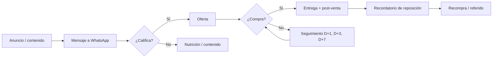

# Embudos de venta

Un embudo de venta es el sistema que lleva a una persona concreta desde no conocer el negocio hasta comprar, volver a comprar y recomendar, **un paso medible a la vez**. Tiene forma de embudo porque en cada paso avanza solo una parte; el trabajo consiste en decidir qué paso pedir, con qué mensaje y oferta, y medir dónde se pierde la gente.

El entregable de esta skill no es teoría: es un documento que un equipo pequeño pueda implementar en 1–3 semanas, con los textos escritos, las reglas de seguimiento, los números que debe alcanzar y los criterios para saber si funciona.

## Dónde se guardan los resultados

Todo se guarda en la carpeta `embudos/` de la raíz del proyecto; créala si no existe. En el repositorio de Canívoros, lee primero `AGENTS.md` de la raíz y `embudos/AGENTS.md`: **mandan sobre esta skill** (por ejemplo, el precio y el margen de Canívoros son `desconocido` hasta que se confirmen, y todo es borrador hasta que Andrés lo apruebe). Si esas guías cambian, sigue la versión vigente y avisa de la diferencia.

```
embudos/
├── EMBUDOS.md                   # registro: una fila por embudo, con ID E01, E02… que no se reutiliza
└── E01-<negocio>-<tipo>/
    ├── embudo.md                # el entregable, hecho con assets/plantilla-embudo.md
    ├── calculo.json             # entradas de la calculadora
    ├── numeros.md               # salida de la calculadora
    └── auditoria-AAAA-MM-DD.md  # revisiones posteriores con datos reales
```

- **Embudo nuevo.** Desde la raíz del proyecto (ajusta la ruta si la skill está instalada en otro lugar):

  ```bash
  python3 .claude/skills/embudos-de-venta/scripts/nuevo_embudo.py "<negocio> <tipo>" --negocio "<negocio>" --tipo "<tipo de embudo>" --objetivo "<meta y plazo>"
  ```

  Crea la carpeta con el siguiente ID, `embudo.md` desde la plantilla, un `calculo.json` para completar y la fila en `EMBUDOS.md` (crea el registro si no existe). No sobrescribe nada.
- **Embudo que ya existe** (mismo negocio y tipo, o el usuario lo nombra): búscalo en `EMBUDOS.md`, actualiza los archivos de su carpeta, anota el cambio en la sección «Historial» de `embudo.md` y actualiza «Estado» y «Última revisión» en el registro. No crees una copia.
- **Sin sistema de archivos:** entrega el documento en el chat con la misma estructura.

## Principios que guían todas las decisiones

- **La oferta va antes que el tráfico.** Más visitas a una oferta débil solo amplifican la pérdida. Si la oferta, el precio o la entrega no cierran, arréglalos antes de diseñar anuncios.
- **Un público, una oferta y un siguiente paso por pieza.** Cada anuncio, página o mensaje pide una sola acción. Dos llamados a la acción compiten entre sí.
- **Diseña de atrás hacia adelante.** Empieza por la venta (y la recompra) y retrocede hasta la fuente de tráfico; las metas también se calculan así: clientes → leads calificados → leads → clics → alcance.
- **El seguimiento es parte del embudo.** En ventas conversacionales (WhatsApp, DM, llamada) muchas oportunidades se pierden por responder tarde o no volver a escribir. Define tiempo de respuesta, responsable y cadencia de seguimiento.
- **Lo que no tiene origen no se puede mejorar.** Cada contacto debe guardar de dónde vino (campaña, anuncio, aliado, código) y en qué etapa está.
- **Separa datos, supuestos y metas.** Marca cada número como *dato* (medido por el negocio), *supuesto* (estimación a validar) o *meta*. Nunca presentes un supuesto ni una referencia genérica de industria como dato del negocio. Si el usuario no tiene datos, el plan incluye cómo medirlos.
- **Honestidad comercial.** No inventes testimonios, cifras de resultados, escasez ni urgencia falsas. Las afirmaciones de salud, ahorro o rendimiento necesitan soporte. Los mensajes por WhatsApp o email requieren permiso del contacto (en Colombia, Ley 1581 de 2012; en otros países, la norma local de datos personales).

## Flujo de trabajo

### 1. Diagnóstico rápido

Antes de preguntar, usa lo que ya existe: si estás en un repositorio o carpeta con documentos del negocio (referencia de la empresa, planes, ventas, backlog), léelos primero. Si el usuario compartió material de referencia (un video, una transcripción, una plantilla o un método que quiere seguir), adopta esa metodología y su vocabulario por encima de los valores por defecto de esta skill; si no puedes acceder a una URL, dilo y no inventes su contenido.

Necesitas saber:

| Tema | Preguntas clave |
|---|---|
| Producto y precio | ¿Qué se vende? ¿Precio o ticket promedio? ¿Costo variable o margen aproximado? |
| Cliente | ¿Quién compra y quién decide (B2C, B2B, distribuidor)? ¿Qué problema o deseo lo mueve? ¿Qué usa hoy en su lugar? ¿Qué le impide comprar? |
| Cierre de la venta | ¿Dónde se concreta hoy: WhatsApp, web, llamada, visita, tienda, distribuidor? ¿Quién atiende? |
| Tráfico y audiencia | ¿Redes, base de clientes, anuncios, aliados, referidos? ¿Qué volumen tienen? |
| Datos actuales | Leads por mes, conversiones, recompra, costo de anuncios (lo que exista) |
| Objetivo y límites | Meta concreta y plazo, presupuesto, capacidad de atención y de producción/entrega |
| Herramientas | CRM, ERP (p. ej. Odoo), WhatsApp Business, tienda online, email |

Si faltan los tres datos imprescindibles —**qué se vende, a quién y dónde se cierra la venta**— haz una sola ronda de 3 a 5 preguntas concretas y espera. Si esos tres están claros, no frenes el trabajo por el resto: avanza con supuestos explícitos y lista al final qué conviene confirmar.

### 2. Elegir el tipo de embudo

Elige según el ticket, cuánto hay que educar al cliente, la temperatura del tráfico (frío, tibio, caliente) y el canal donde se cierra la venta.

| Situación | Embudo base |
|---|---|
| La venta se cierra conversando (común en LatAm) | Conversacional por WhatsApp / DM |
| Producto de consumo recurrente (alimentos, insumos, cosméticos) | Primera compra + recompra (recordatorio o suscripción) |
| Ticket bajo, compra rápida, tienda online | E-commerce con complemento (order bump), upsell y recuperación de carrito |
| Ticket medio que necesita educación o confianza | Imán de leads + secuencia de nutrición |
| Ticket alto, servicio, consultoría, B2B complejo | Contenido / clase / VSL → aplicación → llamada de diagnóstico |
| Venta a tiendas, distribuidores o empresas | B2B: prospección → muestra o pedido piloto → reposición → venta al consumidor |
| Negocio local con citas (clínica, taller, estética) | Agenda: consulta → cita → recordatorio → asistencia → reseña |
| Lista o base de clientes inactiva | Reactivación |
| Producto nuevo con fecha de apertura | Lanzamiento |

Lo normal es combinar un embudo de **adquisición** (cómo llega el primer cliente) con uno de **retención** (cómo vuelve y recomienda); la rentabilidad suele estar en la segunda compra. Lee `references/tipos-de-embudo.md` para las etapas, piezas, métricas y fallos típicos del tipo elegido.

### 3. Diseñar la oferta (escalera de valor)

Define cada peldaño que aplique, con precio, qué incluye y por qué existe:

1. **Imán de leads** (gratis a cambio del contacto): resuelve un problema pequeño y específico relacionado con la oferta principal. Un imán desconectado atrae a gente que nunca comprará.
2. **Oferta de entrada** (bajo riesgo: muestra, kit de prueba, diagnóstico pagado, primera clase): convierte al interesado en cliente. Su objetivo es cubrir parte del costo de adquisición y generar confianza; verifica que no destruya margen.
3. **Oferta principal**: lo que genera la mayor parte del ingreso.
4. **Complementos**: order bump (en el checkout), upsell (después de comprar), cross-sell, downsell (alternativa menor si dice no).
5. **Continuidad**: suscripción, recordatorio de reposición, membresía, retainer o contrato.

Para que la oferta sea irresistible sin mentir, refuerza el valor percibido: **resultado concreto** que obtiene, **prueba** de que funciona (demostraciones, casos reales, garantía), **menos esfuerzo y tiempo** para el cliente y **reversión del riesgo** (garantía, prueba, pago contra entrega). La urgencia solo vale si es real (cupos de producción, fecha de entrega, precio de lanzamiento con fecha).

### 4. Mapa del embudo

Para cada etapa define: **objetivo, público, mensaje, pieza o activo, canal, siguiente paso (CTA), responsable, automatización y métrica.** Las etapas típicas son atracción → captación → calificación/nutrición → oferta → objeciones y seguimiento → cierre → entrega/onboarding → retención/recompra → referidos; adapta los nombres al negocio y omite las que no apliquen.

Incluye un diagrama Mermaid (se ve en GitHub y en la mayoría de editores) con las ramas importantes —no responde, no compra, compra, vuelve a comprar—, no solo la línea recta:



### 5. Escribir los activos

Escribe los textos completos y listos para usar, no solo indicaciones como "aquí va un titular". Como mínimo, para las piezas de las que depende el embudo elegido:

- 2–3 variantes de anuncio o publicación con ángulos distintos (dolor, deseo, prueba).
- Landing o mensaje de oferta con estructura completa.
- Guiones de WhatsApp/DM: bienvenida, preguntas de calificación, presentación de la oferta, respuestas a las 3–5 objeciones más probables, seguimiento y cierre.
- Secuencia de emails o mensajes de nutrición, post-venta, reposición o reactivación, según el tipo.
- Guion de llamada si el cierre es por llamada.

Usa las palabras del cliente (de entrevistas, reseñas, mensajes reales) cuando existan. Lee `references/copywriting.md` para fórmulas, estructuras y plantillas de mensajes.

### 6. Automatización y registro

Define las etapas del CRM como reflejo del embudo, los campos mínimos (con **origen** y **permiso de comunicaciones**), las reglas de seguimiento (qué pasa si no responde en 24 h, si compra, cuándo toca reponer) y cuándo interviene una persona. Empieza con lo más simple que funcione (hoja de cálculo + WhatsApp Business) y automatiza lo repetitivo cuando el proceso manual esté validado. Lee `references/automatizacion.md`.

### 7. Números: metas, costos y punto de equilibrio

Calcula con el script en lugar de hacerlo a mano; evita errores y deja trazabilidad:

```bash
python3 .claude/skills/embudos-de-venta/scripts/calcular_embudo.py embudos/E01-<nombre>/calculo.json --escenarios --mermaid --guardar
```

`--guardar` escribe `numeros.md` en la carpeta del embudo. Antes, completa `calculo.json` (lo creó `nuevo_embudo.py`; `--ejemplo` imprime uno completo de referencia) con las etapas del embudo, la tasa de conversión de cada paso (`"fuente": "dato"` o `"supuesto"`), la meta (`modo: "meta"` con `meta_clientes` o `meta_ingresos`) o el volumen de entrada (`modo: "volumen"`), el costo de medios y la economía (precio, costo variable, compras por cliente). Si el precio o el costo son `desconocido`, déjalos en `null`: el reporte calcula los volúmenes y deja el dinero pendiente. El reporte da volumen necesario por etapa, costo por lead y por cliente (CAC), contribución, LTV, ROAS de equilibrio y escenarios. Resume sus cifras clave en la sección «Números» de `embudo.md`, enlaza `numeros.md` y explica las conclusiones: ¿cuánto se puede pagar por cliente?, ¿alcanza el presupuesto?, ¿qué etapa conviene mejorar primero?

Si no hay datos propios para las tasas, usa supuestos conservadores, márcalos como tales y explica que deben reemplazarse con 2–4 semanas de medición. Las definiciones y fórmulas están en `references/metricas.md`.

### 8. Plan de lanzamiento y experimentos

- **Checklist previo**: seguimiento de origen funcionando, formularios y enlaces probados, responsable de respuesta asignado, permisos de datos, textos aprobados, inventario/capacidad confirmada.
- **Calendario** de 2–4 semanas: qué se construye, qué se lanza y cuándo se revisa.
- **Experimentos** (máximo 1–3 a la vez): hipótesis, variable que cambia (una sola), métrica principal, umbral de decisión acordado **antes** de lanzar y presupuesto máximo. Con pocas conversiones, trata los resultados como indicios, no como ganadores definitivos.
- **Tablero semanal** con las métricas por etapa.

## Formato del entregable

Completa `embudo.md` en la carpeta del embudo siguiendo la estructura de `assets/plantilla-embudo.md` (ya copiada por `nuevo_embudo.py`). No dejes corchetes sin rellenar: lo que no se sabe se escribe `desconocido`.

Al terminar, responde en el chat en 5 líneas: embudo y objetivo, números clave, qué quedó `desconocido` o como supuesto, la carpeta donde quedó y qué debe decidir el responsable del negocio.

Responde en el idioma del usuario (español por defecto; portugués si escribe en portugués) y con la moneda de su mercado.

## Auditar u optimizar un embudo existente

Cuando el usuario ya tiene un embudo y quiere saber por qué no vende:

1. Reúne los números por etapa del mismo periodo (alcance, clics, visitas, leads, conversaciones, oportunidades, ventas, recompras) y el gasto.
2. Calcula la conversión de cada paso con `scripts/calcular_embudo.py` en `modo: "volumen"`, dando a cada etapa su `"volumen"` observado en lugar de una tasa (el script deriva las tasas y las marca como dato), junto con la economía unitaria (CAC frente a contribución y LTV).
3. Encuentra la fuga principal: la etapa con la peor conversión frente a su propio historial, frente a otras campañas del negocio o, como último recurso, frente a una referencia genérica declarada como tal.
4. Diagnostica con la tabla de síntomas de `references/metricas.md` (p. ej. muchos clics y pocos leads → desconexión entre anuncio y página u oferta; muchos leads y pocas ventas → calificación, oferta, precio o seguimiento).
5. Prioriza 3–5 acciones por impacto, confianza y facilidad, empezando por las etapas más cercanas a la venta: mejorar el cierre suele ser más barato que comprar más tráfico.
6. Si la economía unitaria no cierra (CAC mayor que la contribución y sin recompra que lo compense), dilo con claridad antes de recomendar más inversión.
7. Guarda la auditoría en la carpeta del embudo: los datos observados en `auditoria-AAAA-MM-DD.json` y el informe en `auditoria-AAAA-MM-DD.md` (genera los números con `--salida` hacia ese archivo o pégalos en él). Si el embudo no estaba registrado, créalo antes con `nuevo_embudo.py`. Actualiza «Última revisión» en `EMBUDOS.md`.

## Errores comunes a evitar

- Enviar más tráfico a un embudo que todavía no convierte.
- Imán de leads o contenido que atrae a un público que no puede o no quiere comprar.
- Pedir demasiados datos o pasos antes de entregar valor.
- Medir solo ventas totales y no la conversión de cada etapa.
- Olvidar la post-venta: sin recompra, muchos embudos de consumo no son rentables.
- Automatizar mensajes antes de validar el proceso manual, o sin permiso del contacto.
- Prometer resultados garantizados o usar urgencia falsa.

## Archivos de referencia

| Archivo | Cuándo leerlo |
|---|---|
| `references/tipos-de-embudo.md` | Al elegir el tipo de embudo: etapas, piezas, métricas y fallos de cada uno |
| `references/copywriting.md` | Al escribir anuncios, landing, mensajes de WhatsApp, emails, guiones y objeciones |
| `references/automatizacion.md` | Al definir CRM, campos, reglas de seguimiento, herramientas, atribución y permisos |
| `references/metricas.md` | Al calcular metas, definir indicadores, armar el tablero o auditar un embudo |
| `assets/plantilla-embudo.md` | Estructura de `embudo.md` |
| `assets/EMBUDOS.md` | Plantilla del registro de embudos |
| `scripts/nuevo_embudo.py` | Para crear y registrar la carpeta de un embudo nuevo |
| `scripts/calcular_embudo.py` | Para todos los cálculos de volúmenes, costos y economía unitaria |
