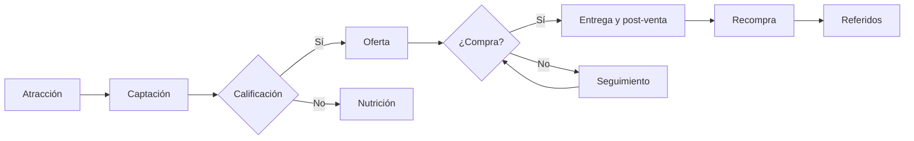

# {{ID}} · Embudo de venta: {{NOMBRE}}

Creado: {{FECHA}} · Estado: borrador para validar · Registro: `EMBUDOS.md`

> **Convención de números:** *dato* = medido por el negocio · *supuesto* = estimación a validar · *meta* = objetivo acordado.

## 1. Resumen

- **Objetivo:** [meta concreta y plazo, p. ej. 60 clientes nuevos/mes con recompra en 45 días]
- **Público principal:** [quién compra, situación, problema o deseo]
- **Oferta:** [qué se ofrece, precio, condiciones]
- **Tipo de embudo:** [adquisición] + [retención] — [por qué se eligió]
- **Números clave:** [leads necesarios, presupuesto, CAC máximo, LTV]
- **Lo que hay que confirmar antes de lanzar:** [lista corta]

## 2. Diagnóstico

| Tema | Lo que sabemos | Fuente (dato/supuesto) |
|---|---|---|
| Producto y precio | | |
| Cliente y problema | | |
| Dónde se cierra la venta | | |
| Tráfico y audiencia actual | | |
| Capacidad y límites | | |

## 3. Oferta y escalera de valor

| Peldaño | Qué es | Precio | Objetivo |
|---|---|---|---|
| Imán de leads | | Gratis | |
| Oferta de entrada | | | |
| Oferta principal | | | |
| Complemento / upsell | | | |
| Continuidad | | | |

Garantía o reversión del riesgo: [ ]. Urgencia real (si existe): [ ].

## 4. Mapa del embudo

| Etapa | Objetivo | Mensaje / pieza | Canal | CTA | Responsable | Automatización | Métrica |
|---|---|---|---|---|---|---|---|
| | | | | | | | |

## 5. Activos (textos listos para usar)

### 5.1 Anuncios / publicaciones
### 5.2 Landing o mensaje de oferta
### 5.3 Guiones de WhatsApp / DM (bienvenida, calificación, oferta, seguimiento, cierre)
### 5.4 Objeciones y respuestas
### 5.5 Secuencias (nutrición, post-venta, reposición, reactivación)

## 6. Operación: CRM y automatización

- **Etapas del pipeline:** [ ]
- **Campos mínimos:** [incluye origen y permiso de comunicaciones]
- **Reglas de seguimiento:** [disparador → acción → responsable]
- **Herramientas:** [nivel 0/1/2 y por qué]
- **Atribución:** [UTM, enlaces de WhatsApp con texto, códigos de aliado]
- **Permisos y cumplimiento:** [ ]

## 7. Números

Detalle completo en [numeros.md](numeros.md) (salida de `calcular_embudo.py`; entradas en `calculo.json`).

[Cifras clave y conclusiones: volumen necesario por etapa, presupuesto, CAC máximo, qué etapa es crítica, qué pasa en el escenario pesimista. Lo que no se sabe: `desconocido`.]

## 8. Plan de lanzamiento

### Checklist previo
- [ ] Origen de cada contacto registrado (UTM, texto de WhatsApp, código)
- [ ] Enlaces, formularios y pagos probados de punta a punta
- [ ] Responsable y horario de respuesta definidos
- [ ] Permiso de comunicaciones y política de datos
- [ ] Textos y afirmaciones revisados (con soporte)
- [ ] Capacidad de producción/entrega confirmada

### Calendario
| Semana | Construir | Lanzar | Revisar |
|---|---|---|---|

### Experimentos
| # | Hipótesis | Variable | Métrica | Umbral de decisión | Presupuesto máx. |
|---|---|---|---|---|---|

### Tablero semanal
[Columnas: semana, volumen y conversión por etapa, gasto, CPL, CAC, ventas, ticket, recompras, bajas.]

## 9. Supuestos y preguntas abiertas

| Supuesto o pregunta | Cómo se valida | Responsable | Fecha |
|---|---|---|---|

## Historial

| Fecha | Cambio | Motivo |
|---|---|---|
| {{FECHA}} | Creación del borrador | |
