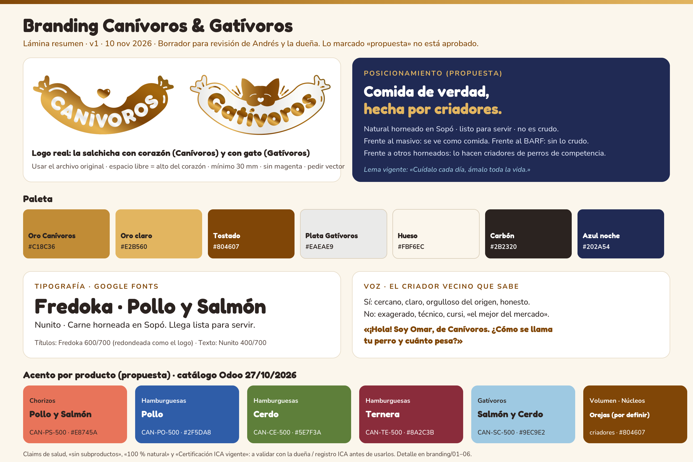

# Branding Canívoros & Gatívoros

Versión 1 · 10 nov 2026 · **Borrador de trabajo para Andrés.** No está aprobado por la empresa. No publicar, imprimir ni enviar a terceros sin revisión.

## Índice

| Archivo | Qué tiene | Para quién |
|---|---|---|
| [01-estrategia-posicionamiento.md](01-estrategia-posicionamiento.md) | Público por motivación, alternativas del comprador, propuesta de valor, diferencial frente a masivos, BARF y Pixie, arquitectura de marca y pilares | Andrés, dueña, Sebastián |
| [02-personalidad-y-voz.md](02-personalidad-y-voz.md) | Arquetipo, tono, qué sí y qué no decir, frases para WhatsApp, Instagram y empaque | Omar, quien escriba contenido |
| [03-mensajes.md](03-mensajes.md) | Taglines candidatos, mensaje central, mensajes por segmento, objeciones y respuestas, mensajes prohibidos | Ventas, anuncios, WhatsApp |
| [04-identidad-visual.md](04-identidad-visual.md) | Logo real y reglas, paleta con HEX, tipografía, fotografía, íconos y grilla de Instagram | Diseñador, quien haga posts |
| [05-aplicacion-por-producto.md](05-aplicacion-por-producto.md) | Una ficha por producto real: proteína, especie, mensaje, color, frente de empaque y post | Diseño de empaque, contenido |
| [06-analisis-competidor-friskies.md](06-analisis-competidor-friskies.md) | Qué hace Friskies Brasil, qué copiar y qué evitar | Estrategia de contenido |
| `assets/paleta.svg` · `assets/paleta.png` | Paleta completa | Diseño |
| `assets/lamina-branding.svg` · `assets/lamina-branding.png` | Lámina resumen (2400 × 1600) | Presentar el branding en una sola imagen |
| `assets/referencia/` | Logo e ícono tal como están publicados en canivoros.com (PNG, sin modificar) | Referencia; pedir el vector a la empresa |

## Cómo usarlo

1. **Antes de escribir algo**, lee la tabla «Qué sí decir y qué no decir» de `02` y la lista de mensajes prohibidos de `03`.
2. **Antes de diseñar**, usa la paleta y las reglas de logo de `04`, y el color de acento del producto en `05`.
3. **Antes de publicar**, pasa la prueba de 4 preguntas de `02` §6 y pide visto bueno a Andrés.
4. **Para medir**, usa los taglines como variantes del experimento BL-020.

## Cómo se marcan los datos

- **[Hecho]**: está en una fuente (repo, sitio, Odoo, Excel).
- **[Declaración]**: lo dice la marca o la dueña; no lo hemos comprobado.
- **[Hipótesis] / [Propuesta]**: idea nuestra para validar.
- `desconocido`: no lo sabemos.
- **a validar con la dueña / registro ICA**: claims de salud, calidad o regulatorios que no se usan hasta tener respaldo.

## Fuentes

- `CANIVOROS-REFERENCIA-EMPRESA.md`, `CANIVOROS-PLAN-CRECIMIENTO-BOGOTA.md`, `erp.md`, `utils/metodologias_analisis_competitivo.md`, `utils/pasos_sysmkt.md`.
- `backlog/`: BL-005, BL-016, BL-019, BL-020, BL-023, BL-026, BL-041, BL-043, BL-058.
- `competencia/competencia-2026-11-03.md`.
- `ventas_canivoros_2026.xlsx`: **solo los nombres de las columnas** para la lista de productos. No se usaron cifras.
- Catálogo de Odoo (captura del chat con Sebastián, 27/10/2026).
- canivoros.com (logo, fotos, CSS), consultado el 10/11/2026.
- Instagram: **no se pudo leer sin sesión** (@canivoros_col ni @friskiesbr). Se usaron el extracto público del buscador, un espejo público de la página de Facebook de Canívoros, purina.com.br y prensa de marketing. Detalle en `06`.

## Qué falta validar con la dueña

1. Catálogo definitivo: receta de Gatívoros (salmón y cerdo, o salmón y pollo), forma de la ternera, qué son «núcleos» y «orejas», y cuál es el «nuevo producto 100 % pollo» (BL-005).
2. Conservación real de cada producto (congelado, refrigerado o ambiente) y vida útil.
3. Número de registro ICA por producto y ficha técnica (proteína, grasa, humedad).
4. Reemplazo del mensaje «sin subproductos» (BL-016).
5. Claims del sitio: horneado que «elimina bacterias», digestión, sistema inmune, limpieza dental, «100 % natural», «libre de granos», «super premium», «alimento completo» (BL-016).
6. Permiso para usar perros de competencia, testimonios y fotos de clientes (BL-058).
7. Archivo vectorial del logo y si el magenta sigue vigente.
8. Precios y niveles de línea antes de separar «Selección» y «Diaria» (BL-005).
