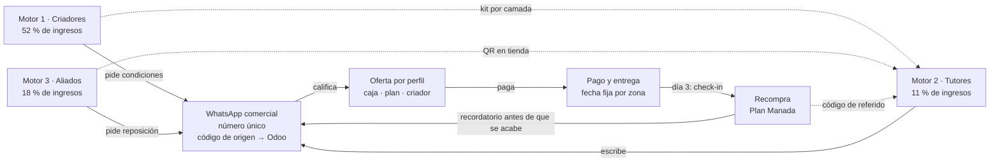
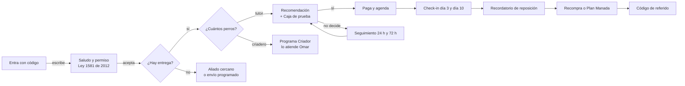

# E01 · Embudo de venta: Canívoros tres motores y recompra

Creado: 2026-11-03 · Estado: borrador para validar (lo aprueba Andrés) · Registro: `EMBUDOS.md`

> **Convención de números:** *dato* = medido por el negocio · *supuesto* = estimación a validar · *meta* = objetivo acordado.

Versión visual con diagramas, guiones copiables y calculadora interactiva: [`embudo.html`](embudo.html). Este archivo es la fuente de verdad; si algo difiere, manda este.

## 1. Resumen

- **Objetivo:** subir los **kilos recurrentes por semana** (kilos entregados a clientes con dos o más compras) en el norte de Bogotá y la Sabana Centro en 90 días (3 nov 2026 – 1 feb 2027). La meta numérica es `desconocido` hasta cerrar la línea base (BL-004).
- **Público principal:** tres motores. (1) Criadores y criaderos; (2) tutores de perros que buscan alimento natural; (3) tiendas, veterinarias y adiestradores.
- **Oferta:** escalera de cinco escalones, de una guía gratis por WhatsApp hasta el Programa Criador (sección 3). Precios `desconocido` hasta BL-005.
- **Tipo de embudo:** conversacional por WhatsApp (adquisición) + recompra con recordatorio y pedido programado (retención). Se dibuja como **corbatín**: la primera compra es el nudo, y el lado derecho (activación, recompra, plan, más kilos, referidos) pesa tanto como el izquierdo. Se eligió porque en los datos de jul–oct los clientes que repiten mueven ≈ 87 % de los kilos (*dato*, sin depurar).
- **Números clave:** escenario del Motor 2 con 1,5 M COP de pauta (*supuesto*): 250 conversaciones → 150 calificados → 37,5 primeras compras; CAC ≈ 40.000 COP. Detalle en [numeros.md](numeros.md).
- **Lo que hay que confirmar antes de lanzar:** precios y unidades (BL-005), margen por producto (BL-025), guía de raciones (BL-041), número de WhatsApp comercial único, revisión de afirmaciones (BL-016), permiso de datos (BL-058), capacidad de producción (BL-036).

## 2. Diagnóstico

Fuente: `ventas_canivoros_2026.xlsx` (jul–oct 2026). Supuestos de lectura: libra = 500 g; nombres de cliente unificados a mano. Solo agregados.

| Tema | Lo que sabemos | Fuente |
|---|---|---|
| Producto y precio | Hamburguesas, chorizos y núcleos horneados de pollo, cerdo, salmón y ternera; paquetes de 500 g y venta por kg a criadores. Precios informados en `erp.md` (p. ej. 6.200 COP/kg a criador, 5.000 COP por paquete de hamburguesa) | Precios: `desconocido` hasta BL-005 |
| Ventas | ≈ 10,5 M COP por mes, promedio jul–sep, con los totales escritos en el Excel | *dato* |
| Mezcla de ingresos jul–sep | Criadores 52 % · tiendas 18 % · cliente final 11 % · núcleos y otros 19 % | *dato* (suma de columnas) |
| Recompra | ≈ 55 clientes; 27 compraron más de una vez; esos clientes mueven ≈ 87 % de los kilos | *dato* (sin depurar) |
| Concentración | El cliente más grande ≈ 24 % de los kilos; los 10 más grandes ≈ 65 % | *dato* |
| Cliente y problema | Criadores de perros de exposición y trabajo que confían en Omar; tutores que buscan alimento natural y fácil de servir | Referencia de la marca; resto `desconocido` hasta entrevistas (BL-006) |
| Dónde se cierra la venta | WhatsApp con Omar; la responsable factura; pago casi siempre antes del despacho | `erp.md` |
| Tráfico y audiencia actual | Relaciones personales, recomendaciones y reputación de Omar; Instagram y Facebook de la marca; sin pauta medida | `erp.md`; volúmenes `desconocido` |
| Geografía | Pedidos en Sopó, Chía, La Calera, Cota, Tabio, Cedritos y Engativá | *dato*; se valida con BL-014 |
| Capacidad y límites | Equipo de cinco personas; capacidad adicional por semana `desconocido` (BL-036) | `erp.md` |

**Tres lecturas que guían el diseño**

1. **El embudo que funciona hoy es de confianza y es B2B.** Los criadores compran entre 40 y 110 kg por pedido, cada una a tres semanas. Hay que volverlo un programa con reglas, fechas y referidos.
2. **La recompra ya es el negocio.** Por eso el lado derecho del corbatín se diseña con el mismo rigor que la captación.
3. **Hay riesgo de concentración y una brecha en el consumidor final.** El motor de tutores es la mayor oportunidad y el más caro de construir. Se enciende después de asegurar los motores con tracción.

## 3. Oferta y escalera de valor

| Peldaño | Qué es | Precio | Objetivo |
|---|---|---|---|
| Imán de leads | Guía de cambio de alimento en 10 días y porción para su perro, por WhatsApp | Gratis | Abrir el chat con permiso |
| Oferta de entrada | Caja de prueba: hamburguesa y chorizo para 1 a 2 semanas, con la guía impresa | `desconocido` (BL-023) | Primera compra pagada |
| Oferta principal | Pedido de reposición en paquetes de 500 g según el peso del perro | `desconocido` (BL-005) | Segunda compra |
| Complemento / upsell | Otra receta, segundo perro, Gatívoros para hogares con gato | `desconocido` | Más kilos por cliente |
| Continuidad | **Plan Manada**: pedido fijo cada 2 o 4 semanas, recordatorio previo y entrega en fecha fija por zona, sin cobro automático al inicio. **Programa Criador**: desde 40 kg, calendario de entregas y kit con QR para cada cachorro que entrega el criadero | `desconocido` | Recompra predecible y referidos |

Para aliados la escalera es: degustación en la visita → pedido inicial pequeño a precio de distribuidor → exhibidor con QR propio → reposición cada 2 a 4 semanas. La prueba de demanda es la reposición, no la compra inicial.

Reversión del riesgo: Caja de prueba pequeña y acompañamiento del cambio de alimento el día 3. Urgencia real: cupos por día de ruta en cada zona. No se usa urgencia inventada.

## 4. Mapa del embudo

**Tres motores, una sola conversación.** Las líneas punteadas son bucles que traen tutores sin pagar pauta.

**La conversación de WhatsApp, con sus ramas.**

**Etapas del corbatín.** Responsables propuestos; se confirman con la empresa.

| Etapa | Objetivo | Mensaje / pieza | Canal | CTA | Responsable | Automatización | Métrica |
|---|---|---|---|---|---|---|---|
| 1 Alcance | Que la zona conozca a Omar y la planta | Pilares «De la pista a tu casa» y «Hecho en Sopó» | Reels, TikTok, exposiciones, anuncios por microzona | Ver perfil | Sebastián + Omar | — | Alcance en la zona, CPM |
| 2 Interés | Explicar el alimento horneado | Carruseles, lives | Instagram | Escribir por WhatsApp | Sebastián | — | Clics a WhatsApp |
| 3 Conversación | Abrir chat con origen | Enlace `wa.me` con texto y código, QR | WhatsApp | Enviar mensaje | Quien atiende | Mensaje precargado | Costo por conversación |
| 4 Calificado | Zona, perros y comida actual | Guion 1 | WhatsApp | Responder 3 preguntas | Quien atiende | Respuesta rápida guardada | % calificado |
| 5 Prueba | Recomendar y ofrecer Caja de prueba | Guion 2 | WhatsApp | Separar la caja | Quien atiende | — | % que compra |
| 6 Primera compra | Cobrar y fijar entrega; pedir permiso de recordatorios | Factura y ruta | WhatsApp + facturación | Pagar | Responsable de operación | — | CAC, entregas a tiempo |
| 7 Activación | Acompañar 14 días | Guion 4 (día 3) y mensaje del día 10 | WhatsApp | Contar cómo va | Quien atiende | Recordatorio interno | % que sigue el día 14 |
| 8 Recompra | Avisar antes de que se acabe | Guion 5 | WhatsApp | Responder SÍ | Quien atiende | Fecha calculada por peso y ración | Recompra 30/60 días |
| 9 Plan Manada | Pedido fijo | Oferta del plan en la 2ª compra | WhatsApp | Entrar al plan | Quien atiende | Lista y ruta fija | % en plan |
| 10 Más kilos | Segundo perro, otra receta, Gatívoros | Oferta cruzada | WhatsApp | Agregar al pedido | Quien atiende | — | Kilos por cliente |
| 11 Embajador | Referidos después de la 2ª compra | Guion 7 | WhatsApp | Compartir código | Quien atiende | Código personal | Clientes nuevos REF |

## 5. Activos (textos listos para usar)

Todo es borrador hasta que Andrés lo apruebe. Los corchetes se reemplazan en cada pieza o chat. Porciones y pauta de cambio salen de la guía confirmada (BL-041); sin guía, no se dan cantidades.

### 5.1 Anuncios / publicaciones

Concepto a probar: **«Lo que comen los campeones, horneado en Sopó.»** Solo con autorización de los dueños de cada perro que aparezca.

- **Ángulo prueba (autoridad).** «King, Juanito y Skadi compiten en las pistas de Colombia. Su comida la hacemos nosotros en Sopó: alimento horneado con pollo, salmón o cerdo, listo para servir. Escríbenos y te decimos cuánto necesita tu perro.» CTA: Enviar mensaje.
- **Ángulo proceso (deseo).** «Carne real, horneada en Sopó y lista para servir. No es crudo ni BARF: abres, sirves y listo. Pide la Caja de prueba para tu perro.» CTA: Enviar mensaje.
- **Ángulo conveniencia (dolor).** «¿Quieres darle algo más natural a tu perro sin cocinar todos los días? Canívoros viene horneado y listo para servir, con entrega en [zona] el [día].» CTA: Enviar mensaje.

Pilares de contenido: De la pista a tu casa (Omar y los campeones) · Hecho en Sopó (planta y horneado) · La prueba del plato (perros de clientes, como experiencia individual y con permiso) · Tutor que sabe (etiquetas, cambio de alimento, conservación) · Criadero aliado (perfiles de criaderos clientes).

### 5.2 Landing o mensaje de oferta

No hay tienda en línea operativa (BL-042). La «landing» es el mensaje de oferta en WhatsApp (guion 2) más una imagen de la Caja de prueba con: qué trae, para cuántos días alcanza según el peso del perro, precio, zona y día de entrega.

### 5.3 Guiones de WhatsApp / DM

**1 · Bienvenida y calificación**
> ¡Hola! Soy [nombre], de Canívoros. Gracias por escribirnos. Para recomendarte bien te hago tres preguntas rápidas:
> 1. ¿En qué barrio o municipio estás?
> 2. ¿Cuántos perros tienes, qué edad tienen y cuánto pesan más o menos?
> 3. ¿Qué comen hoy?
>
> Usamos tus datos para atender tu pedido y, si nos autorizas, para avisarte cuándo reponer. Política de datos: [enlace]

**2 · Recomendación y oferta**
> Gracias, [nombre]. Para [perro], de [peso] kg, te recomiendo empezar con la Caja de prueba: [contenido] por [precio]. Es alimento horneado, hecho en Sopó con [pollo / cerdo / salmón], y viene listo para servir. Tenemos entrega en [zona] el [día]. ¿Te la separo?

**3 · Seguimiento a las 24 horas** (si no responde; a las 72 h, un último mensaje y se etiqueta)
> Hola, [nombre]. ¿Te quedó alguna duda sobre la Caja de prueba para [perro]? Esta semana entregamos en [zona] el [día]. Si quieres te guardo un cupo en esa ruta.

**6 · Invitación a criadero** (la envía Omar)
> Hola, [nombre]. Soy Omar, de Canívoros. Vi tu trabajo con [raza] en [exposición o club]. Alimentamos perros de exposición y de trabajo, y tenemos un programa para criaderos: pedido programado desde 40 kg, entrega en fecha fija y un kit para cada cachorro que entregas. ¿Te muestro las condiciones?

### 5.4 Objeciones y respuestas

| Lo que dice | Respuesta |
|---|---|
| «Está caro» | Costo por día con la ración confirmada y Caja de prueba. Sin descuentos permanentes. |
| «¿Es crudo o BARF?» | No. Es horneado y listo para servir (respuesta oficial de la marca). |
| «Es delicado del estómago» | Cambio gradual con la guía y check-in el día 3. Si hay una condición clínica, primero el veterinario. Sin promesas de resultados. |
| «¿Cuánto le doy?» | Guía de raciones confirmada (BL-041). Sin guía, no se dan cantidades. |
| «Se daña después de abierto» | Conservación según etiqueta y, cuando exista, una presentación menor (la empresa propuso 200 a 350 g). |
| «No me llega» | Aliado más cercano o envío en el próximo día de ruta. Registrar la zona. |

**Afirmaciones (revisión BL-016 antes de pautar)**

- **Usar ya:** horneado y listo para servir; con pollo, salmón o cerdo; hecho en Sopó; no es crudo ni BARF; lo usan criadores de perros de exposición (con autorización).
- **Cuando haya soporte:** registro ICA con número; sin conservantes ni colorantes según ficha técnica; beneficios de digestión, pelaje o defensas; comparaciones de proteína, grasa y humedad.
- **No usar:** «sin subproductos» (la materia prima incluye cabezas de pollo, barriga de salmón y vísceras); «el mejor alimento»; promesas de resultados de salud.

### 5.5 Secuencias (post-venta, reposición, referidos)

**4 · Check-in del día 3**
> Hola, [nombre]. ¿Cómo le ha ido a [perro] con Canívoros estos primeros días? Recuerda hacer el cambio poco a poco: [pauta de transición de la guía]. Si notas algo, cuéntanos. Si [perro] tiene alguna condición de salud, consulta con su veterinario.

**Día 10 · Cierre del cambio**
> Hola, [nombre]. [Perro] ya va por el día 10 con Canívoros. ¿Ya come solo Canívoros o todavía mezclas? Si quieres, te digo cuántos paquetes necesitas al mes para [peso] kg y te avisamos antes de que se acaben.

**5 · Recordatorio de reposición** (solo a quien lo autorizó)
> Hola, [nombre]. Por el pedido del [fecha], a [perro] le queda comida para unos [n] días. ¿Te programamos la entrega del [día]? Responde SÍ y lo dejamos listo. Si prefieres no recibir estos avisos, responde BAJA.

**Oferta de Plan Manada** (en la segunda compra)
> [Nombre], para que no tengas que estar pendiente, podemos dejar fijo el pedido de [perro] cada [2 o 4] semanas, con entrega el [día] en [zona]. Te avisamos dos días antes por si quieres cambiar algo. ¿Lo dejamos programado?

**7 · Referido** (después de la segunda compra, no antes)
> Gracias por seguir con nosotros, [nombre]. Si conoces a alguien con perro que quiera probar Canívoros, compártele tu código [CÓDIGO]. Su primera caja tiene [beneficio] y tú recibes [beneficio] en tu próximo pedido.

## 6. Operación: CRM y automatización

- **Etapas del pipeline:** Nuevo → Calificado → Oferta enviada → Pagado → Entregado → Recompra → Plan Manada; y Perdido, con motivo. Primero como etiquetas de WhatsApp Business; después en Odoo (BL-011).
- **Campos mínimos:** origen (código), canal de cierre, zona, tipo de cliente (criador, tutor, aliado), número de perros y peso informado, etapa, fecha de última compra, permiso de comunicaciones con fecha. Sin datos personales en este repositorio.
- **Reglas de seguimiento:** chat nuevo → respuesta en horario hábil el mismo día · sin respuesta a la oferta → mensaje a las 24 h y a las 72 h, luego Perdido con motivo · entrega → check-in día 3 y día 10 · fecha estimada de fin del paquete − 3 días → recordatorio de reposición (solo con permiso) · segunda compra → oferta de Plan Manada y código de referido · criadero detectado → pasa a Omar.
- **Herramientas:** nivel 0 (WhatsApp Business con etiquetas y respuestas rápidas + hoja compartida) durante las primeras semanas; nivel 1 (Odoo con oportunidades y pedidos) cuando el proceso esté validado. No se automatizan mensajes a terceros hasta validar el proceso manual.
- **Atribución:** código `CV-[fuente]-[pieza]-[zona o aliado]`, p. ej. `CV-AD-HORN-NORTE`. Fuentes: `AD` anuncio, `IG` orgánico, `QR` aliado, `REF` referido, `CRI` criadero. Va en el mensaje precargado: `wa.me/57XXXXXXXXXX?text=Hola%20Canívoros%20(CV-AD-HORN-NORTE)`. Origen y canal de cierre se guardan por separado (BL-021). El número es `desconocido` hasta elegir el WhatsApp comercial único: hoy hay tres publicados.
- **Permisos y cumplimiento:** autorización de datos según la Ley 1581 de 2012, guardada con fecha en el CRM (BL-058); opción BAJA en cada recordatorio.

## 7. Números

Detalle completo en [numeros.md](numeros.md) (salida de `calcular_embudo.py`; entradas en `calculo.json`).

- **Escenario Motor 2, un mes** (*supuesto*): 1,5 M COP de pauta a 6.000 COP por conversación → 250 conversaciones → 150 calificados (60 %) → 37,5 primeras compras (25 %). CAC ≈ 40.000 COP. Pesimista (tasas × 0,7): 18 clientes; optimista (× 1,3): 63.
- **Dinero:** precio, costo variable y margen son `desconocido` (BL-005, BL-025), así que contribución, LTV y ROAS de equilibrio quedan pendientes. La calculadora de `embudo.html` permite probar escenarios con valores de ejemplo, marcados como tales.
- **Regla para leerlo:** con un CAC de 40.000 COP, la contribución de la primera compra casi seguro no lo cubre; el motor de tutores depende de que la recompra ocurra. Por eso se mide recompra a 30 y 60 días antes de subir la pauta.
- **Etapa crítica:** % de calificados que compran (Caja de prueba) y recompra. Mejorar el cierre en WhatsApp es más barato que comprar más tráfico.
- **Métrica norte:** kilos recurrentes por semana. Su línea base es `desconocido` hasta BL-004.

## 8. Plan de lanzamiento

### Checklist previo
- [ ] Origen de cada contacto registrado (texto de WhatsApp con código, QR por aliado, código por criadero)
- [ ] Enlaces, QR y pagos probados de punta a punta
- [ ] Responsable y horario de respuesta definidos; número comercial único
- [ ] Permiso de comunicaciones y política de datos (BL-058)
- [ ] Textos y afirmaciones revisados con soporte (BL-016)
- [ ] Capacidad de producción y rutas confirmadas, con diciembre planeado por festivos (BL-036)

### Calendario
| Semana | Construir | Lanzar | Revisar |
|---|---|---|---|
| 1–2 (3–16 nov) · Fase 0 | Número único, precios (BL-005), línea base (BL-004), permisos, afirmaciones, etiquetas y códigos | — | Línea base de kilos recurrentes |
| 3–6 (17 nov–14 dic) · Fase 1 | Programa Criador, kit por camada, material y QR para tiendas | Programa con el top 10 de criadores (BL-043); 10 tiendas (BL-012) | Pedidos programados, reposición de tiendas |
| 5–10 (1 dic–11 ene) · Fase 2 | Contenido de Omar (BL-019), Caja de prueba (BL-023), recordatorio (BL-022) | Anuncios horneado vs facilidad en dos microzonas (BL-020) | CAC por motor, recompra a 30 días |
| 11–13 (12 ene–1 feb) · Fase 3 | Referidos, Plan Manada formal | Lo que haya funcionado; piloto Gatívoros (BL-026) | Decisión de escalar, ajustar o parar |

### Experimentos

Máximo tres a la vez. Hipótesis y criterio se registran antes de lanzar (BL-044). Umbrales y presupuestos son propuestas que fija Andrés.

| # | Hipótesis | Variable | Métrica | Umbral de decisión | Presupuesto máx. |
|---|---|---|---|---|---|
| 1 | Un programa con fechas fijas sube los kilos programados de los criadores grandes | Programa Criador vs relación actual | Kilos programados a 2 meses | Por fijar con Andrés | Kits y material: `desconocido` |
| 2 | Avisar antes de que se acabe sube la recompra | Recordatorio vs sin recordatorio | Recompra a 30 días | Por fijar | Tiempo del equipo |
| 3 | Un kit con QR por camada trae tutores nuevos | Kit vs sin kit | Clientes nuevos con código CRI | Por fijar | `desconocido` |
| 4 | La Caja de prueba sube la primera compra sin bajar la recompra | Caja vs pedido normal | Primera compra y recompra | Por fijar | `desconocido` |
| 5 | El mensaje de horneado trae clientes calificados más baratos que el de facilidad | Texto del anuncio | Costo por cliente calificado | Por fijar | Por fijar |

Priorización ICE propuesta para discutir (impacto, confianza, facilidad): Programa Criador 8,0 · recordatorio 7,7 · kit por camada 7,0 · referidos 6,0 · 10 tiendas 6,0 · Caja de prueba 5,3 · anuncios 5,3 · Gatívoros 4,0.

### Tablero semanal

Columnas: semana · kilos recurrentes · conversaciones nuevas por origen · % calificado · % cierre · gasto · costo por conversación · CAC por motor · ventas · recompra 30/60 días · % en Plan Manada · bajas de recordatorio · entregas a tiempo (meta operativa propuesta 95 %) · contribución después de captación.

**Reglas al día 90.** Escalar: contribución acumulada positiva después de captación, recompra observada, capacidad disponible y entregas a tiempo cerca del 95 %. Ajustar: muchos chats y pocas compras, compras sin repetición, margen insuficiente o entrega cara. Parar: cada pedido aumenta la pérdida sin señales de recuperar el CAC en el plazo que fije la gerencia.

## 9. Supuestos y preguntas abiertas

| Supuesto o pregunta | Cómo se valida | Responsable | Fecha |
|---|---|---|---|
| Precios, unidades y libra = 500 g | Confirmar catálogo (BL-005) | Sebastián | Semana 1 |
| Margen de contribución por producto | Costo por receta (BL-025) | Sebastián | Semana 3 |
| Ración por peso de perro | Guía confirmada (BL-041) | Omar / Canívoros | Semana 3 |
| Tasas de calificación y cierre (60 % y 25 %) | 2–4 semanas con códigos de origen | Andrés | Fase 2 |
| Costo por conversación de 6.000 COP | Prueba de anuncios (BL-020) | Andrés | Fase 2 |
| Que los criadores acepten un kit por camada | 3 conversaciones con el top 10 (BL-043) | Omar + Andrés | Fase 1 |
| Autorización de los dueños de King, Juanito, Skadi y Dino para usar su imagen | Pedirla por escrito | Omar | Antes de pautar |
| Qué son los «núcleos» y a qué tipo de cliente se venden | Preguntar a la responsable de operación | Andrés | Semana 1 |
| Microzonas del piloto (norte de Bogotá y Sabana Centro) | Matriz de microzonas (BL-014) | Andrés | Semana 3 |

## Historial

| Fecha | Cambio | Motivo |
|---|---|---|
| 2026-11-03 | Creación del borrador con diagnóstico jul–oct, tres motores, guiones, cálculo del Motor 2 y versión visual `embudo.html` | Pedido de diseñar el embudo de ventas de Canívoros |
