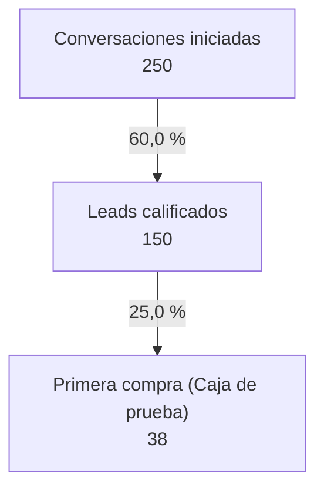

## Números del embudo: E01 · Canívoros tres motores y recompra · Motor 2 (tutores)

Modo **volumen**: resultado esperado a partir de **250** en la primera etapa.

| Etapa | Tasa desde la etapa anterior | Volumen | Costo por unidad | Fuente de la tasa |
|---|---:|---:|---:|---|
| Conversaciones iniciadas | — | 250 | COP 6.000 | supuesto |
| Leads calificados | 60,0 % | 150 | COP 10.000 | supuesto |
| Primera compra (Caja de prueba) | 25,0 % | 37,5 | COP 40.000 | supuesto |

Conversión global (primera → última etapa): **15,000 %**.
Tasas marcadas como supuesto: 2 de 2. Reemplázalas con datos propios tras 2–4 semanas de medición.
Precio o costo variable: `desconocido`. Se calcularon solo volúmenes; la parte de dinero queda pendiente.

### Inversión de adquisición

- Medios: COP 1.500.000
- Total: **COP 1.500.000**

### Escenarios (todas las tasas multiplicadas por un factor)

Las variaciones se multiplican entre etapas: con 2 conversiones, un 30 % peor en cada paso deja el 49 % de los clientes.

| Escenario | Clientes | Inversión total | CAC | Resultado 1.ª compra |
|---|---:|---:|---:|---:|
| Pesimista (tasas x0,7) | 18,4 | COP 1.500.000 | — | — |
| Base | 37,5 | COP 1.500.000 | — | — |
| Optimista (tasas x1,3) | 63,4 | COP 1.500.000 | — | — |

### Diagrama

