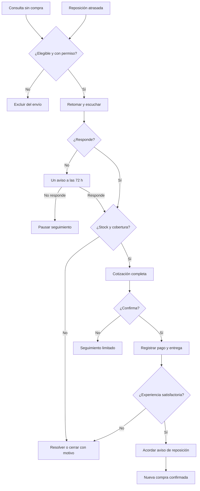

# E02 · Canívoros: recuperar conversaciones y facilitar la recompra

Creado: 2026-11-03 · **Estado: borrador** · Aprobación: Andrés.

[Versión visual interactiva](embudo.html) · [Cálculo de reactivación](numeros.md) · [Cálculo de consultas](numeros-consultas.md).

Este documento es la fuente principal. El HTML funciona sin conexión; no envía mensajes ni guarda datos de clientes. **Dato documental** significa que consta en el repositorio, no que se haya medido nuevamente. **Supuesto** es una estimación. **Meta propuesta** requiere acuerdo. Todos los plazos, tamaños de piloto, tasas y responsables de E02 son propuestas salvo indicación expresa. Lo que falta: `desconocido`.

## 1. Resumen

**Idea central:** vender mejor a quienes ya conocen Canívoros. Resolver qué frenó el pedido, cotizar con precio total y entrega claros, y acordar el siguiente aviso de reposición.

- **Público:** tutores de perros en Bogotá con consultas pendientes o compras anteriores. Operaciones debe confirmar cobertura. Criadores, tiendas y Gatívoros quedan fuera de este piloto para no mezclar ciclos y condiciones.
- **Dos entradas:** A, consulta sin primera compra; B, cliente cuyo ciclo habitual de compra venció. Se miden por separado.
- **Oferta:** un pedido con presentación vigente, total y entrega confirmados. Precio, peso del empaque, costo y margen: `desconocido`. No requiere inventar un kit, regalar producto ni ofrecer descuentos.
- **Meta propuesta principal:** 3 clientes reactivados con pedido pagado y entregado en 14 días por cada 20 clientes elegibles contactados de B. Es un escenario, no una previsión garantizada. La base elegible real es `desconocido`.
- **Retención:** aviso en la fecha elegida por el comprador; medir nueva compra a 30 días y según su ciclo habitual. Meta de recompra: `desconocido` hasta establecer línea base.
- **Pauta nueva propuesta:** 0 COP. **Costo total:** `desconocido`; incluye tiempo comercial, herramientas e incentivos autorizados. No significa costo cero.

E01 conserva su estrategia de tres motores. E02 es un experimento independiente de cierre y reactivación ligado a BL-059, BL-060 y BL-022. No modifica ni sustituye ningún embudo existente.

## 2. Diagnóstico

| Tema | Lo que consta | Fuente y límite |
|---|---|---|
| Producto | Alimento horneado para perros, hecho en Sopó y presentado como listo para servir | [Referencia empresarial](../../CANIVOROS-REFERENCIA-EMPRESA.md); declaración de marca |
| Cierre | Omar atiende WhatsApp; operaciones valida, factura y coordina entrega | [ERP](../../erp.md); descripción operativa |
| Cobro | Puede haber entrega con cobro pendiente | ERP; pago y entrega deben registrarse por separado |
| Consultas perdidas | Existe una tarea de auditoría; volumen y conversión aún desconocidos | [BL-059](../../backlog/BL-059-auditoria-de-consultas-de-whatsapp-2-semanas.md) |
| Clientes anteriores | Existen registros jul–oct 2026 y una tarea de reactivación | [BL-060](../../backlog/BL-060-recuperar-clientes-que-dejaron-de-comprar.md); elegibles desconocidos |
| Atención y economía | Varios números publicados; precios por canal, costos y capacidad por confirmar | Plan Bogotá, BL-005, BL-025, BL-036 |

**Hipótesis:** parte de las consultas se pierde por dudas o falta de seguimiento; parte de los clientes demora la reposición por fricción. No se afirma que esas sean las causas principales hasta revisar respuestas y compras.

No se reanalizó el Excel ni se copiaron datos personales. Los agregados de E01 no se adoptan como línea base de E02: no indican quién puede recibir mensajes ni qué contactos están realmente inactivos.

### Quién entra

| Ruta | Criterio propuesto | Qué comprobar |
|---|---|---|
| A · Consulta pendiente | Consulta de los últimos 30 días, interés identificable, sin primera compra y con permiso vigente para retomar | No hay compra, baja, queja ni seguimiento de E01 activo |
| B · Reposición atrasada | Con al menos 3 compras: última compra hace más de 1,5 veces la mediana de intervalos anteriores | No tiene pedido abierto, producto suficiente ni compra por otro canal |
| B · Historial corto | Con 1–2 compras: fecha de reposición acordada y vencida | Si falta fecha, marcar «ciclo desconocido»; no asumir abandono a 30 días |

La ventana de 30 días y el factor 1,5 son **supuestos de selección**. Revisar candidatos manualmente. Si ya compró, nunca se cuenta como cliente nuevo de A. Los casos de ciclo desconocido se investigan aparte, con permiso, sin inflar el denominador de B.

Atender primero consultas entrantes y quejas. Después, oportunidades con permiso y clientes atrasados. Sin permiso registrado, excluir del envío: no mandar una solicitud de permiso en frío. Esperar una interacción iniciada por la persona u obtenerlo mediante un punto de contacto autorizado.

## 3. Oferta y escalera de valor

**«Tu próximo pedido, con todo claro».**

| Peldaño | Oferta | Precio / condición | Propósito |
|---|---|---|---|
| Ayuda inicial | Confirmar presentación, cobertura y total; escuchar qué frenó el pedido | Sin cobro adicional propuesto | Resolver incertidumbre |
| Entrada A | Menor presentación vigente adecuada a la necesidad expresada | `desconocido`; catálogo y stock confirmados | Facilitar una primera compra |
| Recuperación B | Repetir su referencia anterior si está disponible y la solicita | Cotización vigente, no precio histórico supuesto | Simplificar un pedido conocido |
| Principal | Pedido con cantidades, total y fecha aceptada | Precio y logística `desconocido` | Venta pagada y entregada |
| Complemento | Otra unidad del mismo producto si la necesita y puede conservarla | Catálogo autorizado | Más valor útil por pedido |
| Continuidad | Aviso opcional en la fecha elegida | Cada pedido requiere nueva confirmación | Facilitar la reposición, sin cobro automático |

Reversión del riesgo: total y entrega claros antes de pagar; presentación menor solo si existe. Garantía especial, muestra gratis, envío gratis y descuento: **no ofrecidos; condiciones desconocidas**. Urgencia únicamente si existe un cierre real de ruta confirmado por operaciones.

## 4. Mapa del embudo



| Etapa | Objetivo / pieza | Canal y siguiente paso | Responsable propuesto | Automatización inicial | Métrica |
|---|---|---|---|---|---|
| Elegibilidad A/B | Base depurada y permiso | CRM: validar ruta | Andrés + Omar | Ningún envío | Elegibles / revisados |
| Reconexión | Guion A o B | WhatsApp: responder una pregunta | Comercial | Tarea interna | Respondieron / contactados |
| Diagnóstico | Motivo y necesidad | WhatsApp: confirmar lo que falta | Comercial | Respuesta rápida revisada | Motivos conocidos / respuestas |
| Oferta | Cotización completa | WhatsApp: aceptar propuesta | Comercial + operaciones | Sin promesas automáticas | Cotizados / respuestas |
| Cierre | Confirmación y pago autorizado | Confirmar; después pagar | Comercial | Tarea de cobro | Pagados y entregados / cotizados |
| Entrega | Cumplir lo acordado | Confirmar recepción | Operaciones | Tarea interna | Puntualidad, devoluciones, cartera |
| Retención | Fecha elegida | Autorizar aviso | Comercial | Recordatorio interno | Nueva compra / cohorte madura |

## 5. Activos (borradores completos)

Reconexión solo con permiso validado. No hay conexión ni envío automático. Los datos comerciales salen del catálogo aprobado. Si faltan, se indica que se van a confirmar; no se envía «desconocido» como cotización al cliente.

### 5.1 Publicaciones opcionales

No son necesarias para el experimento. Sus contactos entrantes se registran aparte, con códigos P1/P2/P3; no se mezclan con B.

**P1 · Claridad**
> ¿Quieres conocer Canívoros sin quedarte con dudas sobre el pedido? Dinos tu barrio y te contamos qué presentaciones tenemos, el precio total y las opciones de entrega. Escribe CLARO por mensaje directo.

**P2 · Facilidad**
> Horneado en Sopó y listo para servir: así presenta Canívoros su alimento para perros. Para conocer las presentaciones y la disponibilidad en tu zona, escribe HORNEADO por mensaje directo.

**P3 · Repetir**
> ¿Ya compraste Canívoros y quieres repetir? Revisamos la disponibilidad de tu producto y confirmamos contigo cantidad, precio y entrega. Escribe REPETIR por mensaje directo.

Sin promesas médicas, testimonios inventados, «sin subproductos» ni cupos no verificados.

### 5.2 Mensaje de oferta

**Mientras se valida:**
> Puedo ayudarte con el pedido. Voy a confirmar la presentación disponible, el precio total con entrega y la fecha para tu zona. Te comparto esos datos antes de pedirte que decidas.

**Ficha obligatoria antes de cotizar:** producto y peso neto; cantidad; precio unitario; subtotal; descuento autorizado si aplica; entrega; impuestos aplicables; total final en COP; zona; fecha; forma de pago; condiciones de cancelación/devolución; vigencia. Todos esos valores actuales son `desconocido` hasta confirmación. La ficha se completa con datos reales; no se manda incompleta.

**Texto junto a la ficha completa:**
> Esta es la opción disponible con el detalle del producto, el total y la entrega. ¿Quieres que confirmemos este pedido con esas condiciones?

Si pregunta precio primero, responderlo directamente cuando esté validado. No exigir un cuestionario previo ni revelar el envío solo al final.

### 5.3 WhatsApp: apertura, diagnóstico y cierre

**A · Consulta pendiente**
> Hola, somos Canívoros. Retomamos tu consulta sobre nuestro alimento para perros. ¿Todavía te interesa que revisemos una opción para tu zona? Si prefieres que no retomemos esta conversación, responde BAJA.

**B · Comprador anterior**
> Hola, somos Canívoros. Queremos saber cómo te fue con tu último pedido. ¿Te hace falta reponer o hubo algo que te frenó para volver a comprar? Si prefieres no recibir estos mensajes, responde BAJA.

**Bienvenida a quien escribe**
> ¡Hola! Gracias por escribir a Canívoros. Te ayudamos a revisar presentación, precio y entrega. ¿En qué barrio o municipio necesitas el pedido?

**Diagnóstico, una pregunta por turno**
> ¿Qué necesitas tener claro para decidir: el precio total, la entrega o la presentación?

> ¿Quieres repetir el producto anterior o estás buscando otra presentación?

> ¿Para qué fecha necesitarías el pedido?

No pedir otra vez datos vigentes. Dirección y facturación se solicitan cuando correspondan al pedido mediante el canal autorizado; no pedir identificadores sensibles ni datos completos de pago por chat.

**Sin respuesta inicial · 72 horas**
> Hola, dejamos abierta tu consulta con Canívoros. Si todavía necesitas ayuda con un pedido, puedes responder por aquí. Si ahora no es el momento, cerramos el seguimiento. Para dejar de recibir estos mensajes, responde BAJA.

**Oferta sin respuesta · 24 horas**
> ¿Qué te falta tener claro sobre la propuesta: el total, la presentación o la entrega? Podemos resolverlo antes de que decidas. Si prefieres cerrar el seguimiento, responde BAJA.

**Cierre amable · 72 horas desde la oferta**
> Dejamos esta propuesta en pausa para no insistir. Si quieres retomarla, revisaremos de nuevo precio y disponibilidad. Gracias por conversar con Canívoros. Para no recibir más seguimientos, responde BAJA.

**Pedido aceptado**
> Gracias. Vamos a registrar el pedido con las condiciones que acabas de aceptar y a compartirte el medio de pago autorizado. Te confirmaremos el pago y el estado de la entrega por separado.

### 5.4 Objeciones

| Objeción | Respuesta |
|---|---|
| «Está caro» | «¿Te frena el total del pedido o el costo de entrega? Revisamos una presentación menor si está disponible, con el precio completo antes de decidir». Sin costo diario inventado. |
| «Ya compro otra marca» | «Entiendo. ¿Hay algo que quisieras mejorar de tu pedido actual? Si no necesitas cambiar, podemos dejarlo aquí». |
| «La entrega falló» | «Gracias por contarlo. Primero revisaremos qué pasó y qué solución podemos darte. No te propondremos otro pedido hasta aclararlo». Abrir incidencia. |
| «No le gustó / le cayó mal» | «Gracias por avisarnos. Lo revisaremos con el equipo. Si hubo malestar, consulta con su veterinario antes de cambiar la alimentación. Dejamos la propuesta comercial en pausa». |
| «Todavía tengo» | «Perfecto. ¿En qué fecha prefieres que te preguntemos si necesitas reponer? También podemos dejar que nos escribas tú». |
| «Compro en una tienda» | «¿Prefieres continuar con esa tienda? Podemos orientarte con información de un punto aliado una vez confirmada». No clasificar como perdido ni apropiarse del canal. |
| «Lo pensaré» | «Claro. ¿Hay alguna duda concreta que quieras resolver ahora? Si no, dejamos la propuesta en pausa». |

### 5.5 Entrega, reposición y referidos

**Confirmación de entrega**
> ¿Recibiste el pedido completo y en la fecha acordada? Si hubo alguna diferencia, cuéntanos para revisarla.

**Experiencia · 3 días tras entregar, según permiso**
> ¿Cómo te fue con el pedido de Canívoros? Si tienes alguna duda sobre el producto, la revisamos con el equipo.

**Invitación al aviso, en conversación activa**
> ¿Quieres que Canívoros te envíe un aviso por WhatsApp para preguntarte si necesitas reponer? Tú eliges la fecha y puedes cancelarlo cuando quieras respondiendo BAJA. No se hará ningún pedido ni cobro sin tu confirmación.

Antes de solicitar aceptación, compartir el aviso de privacidad aprobado; URL `desconocido`. Registrar respuesta, fecha y alcance. Un «no» no afecta la atención del pedido.

**Aviso en fecha elegida**
> Hola, te escribimos en la fecha que acordamos con Canívoros. ¿Necesitas reponer o prefieres otra fecha? Si quieres pedir, confirmaremos precio, disponibilidad y entrega. Para dejar de recibir estos avisos, responde BAJA.

**Referido, después de una experiencia satisfactoria**
> Gracias por volver a elegir Canívoros. Si conoces a alguien interesado, puedes compartirle nuestro perfil para que nos escriba directamente. No necesitas enviarnos sus datos.

No ofrecer recompensas no aprobadas. Una incidencia abierta detiene venta adicional, recordatorio y solicitud de referido.

## 6. Operación: CRM y seguimiento

Comenzar con el registro comercial actual y tareas internas. Trasladar a Odoo cuando el proceso esté validado; no requiere contratar herramientas ni conectar un bot.

**Estados:** Elegible → Contactado → Respondió → Cotizado → Pedido confirmado → Venta completada → Reposición acordada. Alternativos: Sin permiso, En pausa, Incidencia, Perdido con motivo, Baja. Venta completada exige pago y entrega comprobados; esos dos estados también se conservan separados.

**Campos, solo en entorno privado:** ID interno; ruta A/B; tipo de cliente; zona; permiso y evidencia; origen inicial; campaña E02; grupo; fecha de asignación; primer intento; respuesta; cotización; próxima acción; responsable; pedido; pago; entrega; devolución; motivo; fecha y autorización de reposición. No subir nombres, teléfonos, direcciones, chats ni exportaciones de clientes al repositorio.

**Atribución:** conservar origen inicial; añadir campaña de recuperación E02, ruta, pieza y grupo. E02 no reemplaza origen de E01 ni del aliado. Un ID de cliente y un ID de pedido evitan duplicados entre números. Motivos cerrados: precio, entrega, falta de stock, aún tiene producto, otra marca, otro canal, experiencia negativa, no responde, otro, desconocido.

| Disparador | Acción propuesta | Límite |
|---|---|---|
| Consulta entrante | Respuesta humana en ≤30 min dentro del horario atendido | Meta; horario y suplente desconocidos |
| Inicio de piloto | Hasta 5 contactos nuevos por día | Reducir si se acumulan tareas |
| No responde al primer mensaje | Un aviso a las 72 h; luego pausar | Máximo 2 mensajes proactivos sin respuesta |
| Responde y recibe oferta | Seguimiento a 24 h y cierre a 72 h si sigue pendiente | Máximo 3 mensajes comerciales proactivos por persona en 7 días, incluida reconexión; omitir los que excedan el límite |
| Compra, pide otra fecha o rechaza | Cancelar tareas comerciales pendientes | No seguir una secuencia obsoleta |
| BAJA o equivalente | Revocar permiso y cancelar campañas en todos los números | Mantener exclusión, no solo borrar etiqueta |
| Queja o condición clínica | Escalar a persona; detener oferta | Resolver servicio; sin consejo veterinario del vendedor |
| Reposición | Avisar en fecha elegida | Sin porción inventada; estimar duración solo con gramos y consumo total confirmados |

La política de WhatsApp requiere permiso para mensajes posteriores y respeto de las bajas. Si se usa **WhatsApp Business Platform**, fuera de las 24 h desde el último mensaje del usuario se necesitan plantillas aprobadas; aprobar este documento no las sustituye. Esa condición de plantillas corresponde a Platform, no a la app manual. [Fuente primaria consultada el 2026-11-03](https://business.whatsapp.com/policy).

## 7. Números y medición

### B · Reactivación (principal)

[Entradas](calculo.json) · [Reporte reproducible](numeros.md).

| Etapa, misma cohorte y ventana de 14 días | Volumen ilustrativo | Tasa supuesta |
|---|---:|---:|
| Clientes elegibles contactados | 20 | Base hipotética; real desconocida |
| Responden | 10 | 50 % |
| Reciben cotización válida | 6 | 60 % |
| Pedido pagado y entregado | 3 | 50 % |

Conversión completa: **15 %**. Sensibilidad multiplicando todas las tasas por 0,7 / 1 / 1,3: **1,029 / 3 / 6,591 clientes esperados**. Los decimales son expectativas, no personas observadas. El reporte redondea para mostrar.

### A · Consulta sin compra (separado)

[Entradas](calculo-consultas.json) · [Reporte](numeros-consultas.md).

10 consultas elegibles × 50 % responde × 80 % recibe cotización × 40 % completa primera compra = **1,6 compradores esperados**. Todo es supuesto. No sumar A+B como objetivo aprobado ni llamar cliente nuevo a un reactivado.

**Prioridad propuesta:** cotización → venta completada, una vez resuelta atención y cobertura. En B, pasar de 50 % a 60 % de cierre llevaría la expectativa de 3 a 3,6 si todo lo demás sigue igual. Es sensibilidad matemática, no evidencia de que se alcanzará. Elegir la fuga real después de medir.

### Economía

Precio, costo, ingreso recuperado, contribución y costo por reactivado: `desconocido`. Los JSON no calculan dinero; el costo de medios vacío evita presentar trabajo gratuito. La pauta nueva propuesta de cero se registra por separado.

- **Venta neta:** importe vendido menos descuentos y devoluciones, con tratamiento consistente de impuestos.
- **Contribución del pedido:** venta neta menos producto, empaque, entrega, comisiones y otros costos variables. No descontar dos veces el descuento ya deducido de ventas.
- **Costo por reactivado observado:** costo comercial total B / compradores reactivados. No es CAC de cliente nuevo.
- **Contribución del piloto:** contribuciones de pedidos menos costo comercial completo, incluidas horas de contactos que no compraron.
- **Resultado incremental estimado:** diferencia entre contribución por asignado de tratamiento y de control, multiplicada por el tamaño del tratamiento, menos costo adicional del tratamiento.

Sin compradores, mostrar «sin compradores», no costo cero. Sin costos completos, no afirmar rentabilidad. Una recompra futura no medida no justifica pérdidas actuales.

### Denominadores y ventanas

Contar personas únicas. El embudo diagnóstico usa eventos anidados: respuestas/contactados, cotizaciones/respuestas, completados/cotizados. Conservar intentos fallidos en contactados y reportarlos aparte; no eliminarlos después de conocer resultados.

El experimento usa **todos los asignados** a cada grupo y compras por cualquier canal, incluso si no respondieron al mensaje. Esas ventas cuentan en la comparación causal aunque no pasen por el embudo conversacional; mostrar ambos recuentos por separado.

**Nueva compra a 30 días:** clientes con otro pedido completado dentro de 30 días de la entrega recuperada / recuperados que ya completaron esa ventana. Los demás quedan pendientes, no como fracasos. Reportar también kilos netos e intervalo habitual; todavía tener producto no equivale a abandono.

## 8. Plan de lanzamiento

El día 0 es la preparación completa y aprobación, no la fecha de este archivo. No se ha iniciado ninguna campaña.

### Checklist previo

- [ ] Número comercial, horario, responsable y suplente.
- [ ] Catálogo, pesos, precios, stock y rutas; cotización completa probada.
- [ ] Base depurada, permisos, bajas y quejas revisados.
- [ ] Separación E01/E02 y A/B; sin campañas simultáneas a una persona.
- [ ] Pago autorizado y registro de cobro/entrega verificados.
- [ ] Aviso de privacidad y textos aprobados; afirmaciones respaldadas.
- [ ] Tope de gasto acordado. Propuesta de 8 horas de equipo para preparación y seguimiento inicial; registrar costo horario y gasto real.
- [ ] Capacidad operativa, criterio de decisión y corte escritos antes de empezar.

### Calendario

| Periodo propuesto | Trabajo | Entregable |
|---|---|---|
| Semana 1 | Auditar chats con comercial; depurar base; confirmar catálogo y rutas | Línea base, causas de pérdida y lista privada; límite de gasto |
| Semana 2 | Asignar grupos e iniciar pequeñas cohortes | Hasta 5 contactos nuevos/día y registro de etapas |
| Semana 3 | Cerrar 14 días de las primeras cohortes | Compras, contribución y aprendizajes |
| Semana 4 | Cerrar cohortes restantes y decidir | Repetir, ajustar o parar; límites de evidencia |
| 30 días tras cada entrega recuperada | Revisar nueva compra | Cohortes maduras; no forzar cierre al día 28 |

### Experimento principal B: reconexión frente a atención habitual

**Hipótesis:** reconexión útil y cotización clara aumentan compras completadas y contribución en 14 días.

1. Con ≥40 elegibles comparables: asignar al azar 20 a tratamiento y 20 a control, equilibrando zona y ciclo. Con 10–39: reparto aproximado 1:1 y adaptar volumen. Con menos de 10: aprendizaje cualitativo; no declarar efecto causal.
2. Tratamiento recibe E02-B; control recibe atención habitual si escribe. Nunca retrasar pedidos ni soporte. No enviar otra campaña al control durante su ventana.
3. Mismos productos, precios y condiciones. La intervención es el conjunto de reconexión y seguimiento, no una palabra aislada.
4. Cada cohorte empieza el día de asignación; contactar tratamiento ese día. Medir 14 días completos. Comparar compradores por cualquier canal / todos los asignados, no solo quienes respondieron.
5. Tras el corte, el control puede recibir seguimiento si conserva permiso. Recompra a 30 días queda descriptiva: si el control recibió la intervención después del día 14, no usar esa comparación posterior como prueba causal.

**Meta propuesta:** 15 % de completados en el embudo conversacional B. **Criterio para repetir un lote pequeño:** ≥5 puntos porcentuales de compradores sobre control, contribución incremental positiva con costos completos y ≥95 % de entregas puntuales. Con 20 por grupo, una compra cambia 5 puntos: señal frágil, no validación estadística ni autorización de escala.

**Ajustar:** no mejora, barreras de cobertura o demasiado esfuerzo. **Pausar:** falta permiso, error operativo, gasto alcanza el límite o contribución incremental negativa. Una queja por contacto no deseado obliga a revisar permisos. Con costos desconocidos o base insuficiente, completar medición antes de ampliar.

**Experimento posterior A:** comparar respuesta actual y cotización compacta, con misma oferta y precio. Medir primeras compras completadas a 14 días. Si la atención actual omite información esencial, corregirla para todos; no usar atención deficiente como control. Definir umbral y gasto antes, sin correr ambos experimentos a la vez con una base pequeña.

### Tablero semanal, solo agregados

| Bloque | Campos |
|---|---|
| Cohorte | Ruta, grupo, fecha, asignados, días observados |
| Embudo | Contactados, fallos de mensaje, respondieron, cotizados, confirmados, pagados, entregados, pagados y entregados |
| Experimento | Compradores por cualquier canal/asignados, diferencia de tasas, contribución por asignado |
| Servicio | Mediana y p90 de respuesta en horario, puntualidad, quejas, bajas, motivos de pérdida |
| Economía | Kilos netos, ventas netas, contribución, horas, gasto; desconocido distinto de cero |
| Retención | Avisos autorizados, cohortes maduras, nueva compra a 30 días, intervalo |

## 9. Supuestos y decisiones pendientes

| Dato / decisión | Cómo validar | Responsable propuesto | Momento |
|---|---|---|---|
| Base elegible y permiso | BL-004, BL-058 y BL-059; revisión privada | Andrés + Omar | Antes del piloto |
| Precios, pesos y stock | BL-005 y catálogo; no asumir libra = 500 g | Operaciones + Sebastián | Antes de cotizar |
| Costos y límite de gasto | BL-025; producto, logística, horas y herramientas | Operaciones + Andrés | Antes del piloto |
| Número, horario y cobertura | Unificar atención y validar rutas | Canívoros | Antes de contactar |
| Aviso de privacidad | BL-058; URL aprobada y alcance del permiso | Canívoros | Antes de solicitar aceptación |
| Tasas B 50/60/50 y A 50/80/40 | Sustituir por cohortes completas | Andrés | Al cerrar piloto |
| Meta 3/20, +5 puntos y 95 % puntualidad | Acordar según base y capacidad | Andrés + Canívoros | Antes de asignar |
| Porción y duración | BL-041 o consumo confirmado; mientras tanto fecha elegida | Canívoros | Solo si se estima reposición |

### Fuentes y reproducción

Revisión de `develop`, commit `02ef116c88013f7e3d0d2c5a114f10ed25a5b9f2`, el 2026-11-03. Fuentes: referencia empresarial, ERP, [plan Bogotá](../../CANIVOROS-PLAN-CRECIMIENTO-BOGOTA.md), BL-005, BL-022, BL-059, BL-060 y [E01](../E01-canivoros-tres-motores-recompra/embudo.md). Reglas de WhatsApp contrastadas con la [política oficial](https://business.whatsapp.com/policy), que indicaba actualización del 2026-09-23.

```bash
python3 .claude/skills/embudos-de-venta/scripts/calcular_embudo.py embudos/E02-canivoros-recuperacion-y-recompra/calculo.json --escenarios --guardar
python3 .claude/skills/embudos-de-venta/scripts/calcular_embudo.py embudos/E02-canivoros-recuperacion-y-recompra/calculo-consultas.json --escenarios --salida embudos/E02-canivoros-recuperacion-y-recompra/numeros-consultas.md
```

Los reportes usan «clientes» como rótulo genérico; en B significa clientes existentes reactivados. Columnas monetarias y CAC vacías indican datos faltantes, no costo cero ni CAC de adquisición.

## Historial

| Fecha | Cambio | Motivo |
|---|---|---|
| 2026-11-03 | Creación de E02 con rutas separadas, guiones, reglas, cálculos y visual local | Nuevo embudo para optimizar ventas y preservar los existentes |
