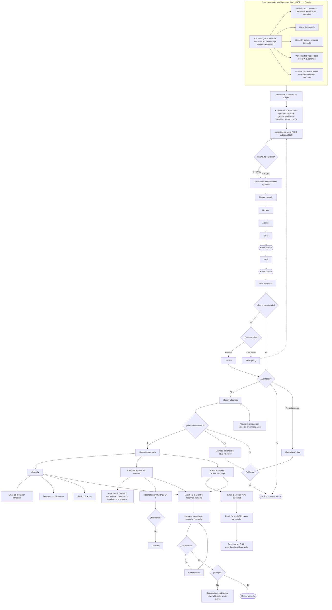

# E03 · Canívoros: embudo de adquisición «Nueva Gen» (clon exacto del video)

Creado: 2026-11-03 · **Estado: borrador** · Aprobación: Andrés.

Este embudo replica **exactamente** el «Embudo de Adquisición Nueva Gen para Agencias/B2B» del video de referencia: mismas etapas, decisiones, ramas (Sí / No / No está seguro), herramientas (Meta, Typeform, Calendly, ActiveCampaign, SMS, WhatsApp) y tiempos (10 min, 1–2 h, 3–4 h, 24 h, 12 h, máximo 3 días). No se adapta ni se simplifica. Solo se reemplaza el contenido de ejemplo por placeholders de Canívoros entre `[[ ]]`.

- No inventa cifras: precios, márgenes, conversiones, presupuesto y casos de éxito son `desconocido` o `[[placeholder]]`.
- Todo texto es **borrador**. No se publican anuncios ni se envían mensajes sin aprobación de Andrés.
- Mensajes a contactos solo con permiso (Ley 1581 de 2012; ver BL-058).
- No sustituye a E01 ni E02.

## 1. Resumen

| Campo | Valor |
|---|---|
| Origen | Video «Embudo de Adquisición Nueva Gen para Agencias/B2B» (clon 1:1) |
| Público | `[[ICP Canívoros por definir en la sección 3]]` |
| Oferta de la llamada | `[[Llamada estratégica Canívoros: qué se ofrece]]` |
| Cerrador | Fundador/cerrador: `[[nombre]]` |
| Presupuesto de anuncios | `desconocido` |
| Precio, margen, CAC, conversión | `desconocido` |

## 2. Mapa completo del embudo

## 3. Base: segmentación hiperespecífica del ICP con Claude

### 3.1 Insumos

| Insumo del original | Contenido Canívoros |
|---|---|
| Grabaciones de llamadas | `[[grabaciones o notas de llamadas de venta de Canívoros]]` — `desconocido` si existen (ver BL-006, BL-007, BL-059) |
| Info del mejor cliente | `[[perfil del mejor cliente]]` — `desconocido`; sale de la línea base (BL-004) |
| El servicio | Alimento natural horneado para perros y gatos (pollo, salmón, cerdo), registro ICA declarado por la marca, hecho en Sopó. Ver `CANIVOROS-REFERENCIA-EMPRESA.md` |

### 3.2 Análisis de competencia

| Competidor | Fortalezas | Debilidades | Nuestra ventaja |
|---|---|---|---|
| `[[competidor 1]]` | `[[ ]]` | `[[ ]]` | `[[ ]]` |
| `[[competidor 2]]` | `[[ ]]` | `[[ ]]` | `[[ ]]` |
| `[[competidor 3]]` | `[[ ]]` | `[[ ]]` | `[[ ]]` |

Fuente sugerida: `competencia/competencia-2026-11-03.md` y BL-015.

### 3.3 Mapa de empatía

| Bloque | Contenido |
|---|---|
| ¿Quién es? | `[[ICP]]` |
| ¿Qué queremos que haga? | `[[acción: reservar la llamada estratégica]]` |
| ¿Qué ve? | `[[ ]]` |
| ¿Qué dice? | `[[ ]]` |
| ¿Qué hace? | `[[ ]]` |
| ¿Qué oye? | `[[ ]]` |
| ¿Qué piensa y siente? — Dolores | `[[ ]]` |
| ¿Qué piensa y siente? — Beneficios | `[[ ]]` |

### 3.4 Situación actual / situación deseada

| Situación actual | Situación deseada |
|---|---|
| `[[ ]]` | `[[ ]]` |

### 3.5 Personalidad y psicología del ICP

| Cuadrante | Motivador | Rasgo | Cómo hablarle (Canívoros) |
|---|---|---|---|
| Dopamina | Inspiración | `[[ ]]` | `[[ ]]` |
| Testosterona | Influencia | `[[ ]]` | `[[ ]]` |
| Oxitocina | Armonía | `[[ ]]` | `[[ ]]` |
| Cortisol | Orden | `[[ ]]` | `[[ ]]` |

Cuadrante dominante del ICP: `[[ ]]`.

### 3.6 Nivel de conciencia y de sofisticación del mercado

- Nivel de conciencia: `[[inconsciente / consciente del problema / de la solución / del producto / muy consciente]]`.
- Nivel de sofisticación del mercado: `[[1–5]]`.

## 4. Etapas paso a paso

| # | Etapa (original) | Detalle | Herramienta | Tiempo | Contenido Canívoros |
|---|---|---|---|---|---|
| 1 | Sistema de anuncios «AI Sniper» | Anuncios generados desde la base del ICP | Claude + Meta | — | `[[ ]]` |
| 2 | Anuncios hiperespecíficos tipo caso de éxito | Gancho, problema, solución, resultado, CTA | Meta Ads | — | Ver 5.1 |
| 3 | Algoritmo de Meta detecta ICP | Facebook e Instagram | Meta | — | Presupuesto `desconocido` |
| 4 | Página de captación | Con VSL o sin VSL | `[[herramienta de landing]]` | — | `[[URL]]` |
| 5 | Formulario de calificación | Tipo de negocio, nombre, apellido, email, envío parcial, móvil, envío parcial, más preguntas | Typeform | — | Ver 5.2 |
| 6 | ¿Envío completado? No | Con teléfono: llamar. Solo email: retargeting | Teléfono / Meta | — | `[[responsable]]` |
| 7 | ¿Calificado? | Sí: reserva llamada · No: «Perdido – para el futuro» · No está seguro: llamada de triaje → ¿calificado? → ¿llamada reservada? | Typeform + CRM | — | Criterios en 5.2 |
| 8 | Llamada saliente | El equipo llama a los leads | Teléfono | — | `[[responsable]]` |
| 9 | Página de gracias | Video de próximos pasos | `[[landing]]` | Inmediato | `[[video]]` |
| 10 | Llamada reservada – Calendly | Email de invitación, recordatorio, SMS | Calendly | Inmediato · 24 h · 12 h | — |
| 11 | Llamada reservada – fundador | WhatsApp de presentación, recordatorio, llamada si no responde | WhatsApp | Inmediato · 24 h | Ver 5.3 |
| 12 | Llamada reservada – email marketing | Autoridad · casos de estudio · recordatorio con valor | ActiveCampaign | 10 min · 1–2 h · 3–4 h | Ver 5.4 |
| 13 | Ventana | Máximo 3 días entre reserva y llamada | Calendly | ≤ 3 días | — |
| 14 | Llamada estratégica | Fundador / cerrador | `[[Zoom/Meet/teléfono]]` | — | `[[cerrador]]` |
| 15 | ¿Se presenta? No | Reprogramar | Calendly | — | — |
| 16 | ¿Compra? No | Secuencia de nutrición y vuelta al boletín según motivo | ActiveCampaign | — | Ver 5.5 |
| 17 | ¿Compra? Sí | Cliente cerrado | CRM | — | — |

## 5. Activos (borradores con placeholders)

> Todos son borradores. Andrés debe aprobarlos. No se envía ni publica nada.

### 5.1 Anuncio tipo caso de éxito

- **Gancho:** `[[gancho]]`
- **Problema:** `[[problema del ICP]]`
- **Solución:** `[[cómo lo resolvió Canívoros]]`
- **Resultado:** `[[resultado real y verificable — no inventar; desconocido hasta tener un caso documentado]]`
- **CTA:** `[[Reserva tu llamada / Completa el formulario]]`

### 5.2 Formulario de calificación (Typeform)

| Orden | Pregunta | Tipo |
|---|---|---|
| 1 | Tipo de negocio | Opción: `[[opciones]]` |
| 2 | Nombre | Texto |
| 3 | Apellido | Texto |
| 4 | Email | Email |
| — | *Envío parcial* | — |
| 5 | Móvil | Teléfono |
| — | *Envío parcial* | — |
| 6+ | Más preguntas | `[[pregunta]]` · `[[pregunta]]` · `[[pregunta]]` |
| — | Consentimiento de datos (Ley 1581) | Casilla |

Criterio de calificación:

| Resultado | Regla |
|---|---|
| Calificado | `[[regla]]` |
| No calificado → «Perdido – para el futuro» | `[[regla]]` |
| No está seguro → llamada de triaje | `[[regla]]` |

### 5.3 WhatsApp del fundador

**Presentación (inmediato):**

> Hola `[[nombre]]`, soy `[[fundador]]` de Canívoros. Vi que reservaste una llamada para el `[[fecha y hora]]`. Te cuento rápido quiénes somos: `[[info de la empresa]]`. Nos vemos en la llamada.

**Recordatorio (24 h):**

> Hola `[[nombre]]`, te recuerdo nuestra llamada de mañana `[[fecha y hora]]`. ¿Sigue en pie?

Si no responde: llamarlo.

### 5.4 Secuencia ActiveCampaign tras la reserva

| Email | Envío | Objetivo | Asunto | Cuerpo |
|---|---|---|---|---|
| 1 | 10 min | Autoridad | `[[ ]]` | `[[ ]]` |
| 2 | 1–2 h | Casos de estudio | `[[ ]]` | `[[caso real documentado; no inventar]]` |
| 3 | 3–4 h | Recordatorio sutil con valor | `[[ ]]` | `[[ ]]` |

Calendly: email de invitación inmediato, recordatorio 24 h, SMS 12 h: `[[textos]]`.

### 5.5 Nutrición si no compra

| Motivo de no compra | Secuencia | Vuelta al boletín |
|---|---|---|
| `[[motivo 1]]` | `[[ ]]` | Sí |
| `[[motivo 2]]` | `[[ ]]` | Sí |
| `[[motivo 3]]` | `[[ ]]` | Sí |

## 6. Métricas por etapa

| Etapa | Métrica | Valor |
|---|---|---|
| Anuncios | Impresiones, CTR, CPL | `desconocido` |
| Página de captación | Visitas → inicio de formulario | `desconocido` |
| Formulario | Envíos parciales / completos | `desconocido` |
| Calificación | % calificados / no / no seguro | `desconocido` |
| Reserva | % que agenda | `desconocido` |
| Asistencia | % show | `desconocido` |
| Cierre | % compra | `desconocido` |
| Economía | Ingreso COP, CAC | `desconocido` |

Fuente de cada número: **dato**, **supuesto** o **meta**.

## 7. Supuestos y preguntas abiertas

| Pregunta | Cómo se valida | Tarea |
|---|---|---|
| Precio, margen y catálogo | Confirmar | BL-005, BL-025 |
| Capacidad de producción para atender más demanda | Medir | BL-036 |
| Permiso de datos para formulario, SMS, WhatsApp y email | Definir política | BL-058 |
| Origen de cada lead | UTM y campo de origen en Odoo | BL-021, BL-011 |
| Quién es el fundador/cerrador | Andrés decide | — |
| Casos de éxito reales para anuncios y email 2 | Documentar | BL-016, BL-043 |

**Riesgo:** la producción es limitada (una máquina). Escalar anuncios sin capacidad confirmada genera leads que no se pueden atender.

## Historial

| Fecha | Cambio | Motivo |
|---|---|---|
| 2026-11-03 | Creación del borrador como clon exacto del video | Pedido de Andrés |
