# E03 · Canívoros: Embudo de Anuncios AI Sniper™ («Embudo de Adquisición Nueva Gen para Agencias / B2B»), clon exacto

Creado: 2026-11-03 · **Estado: borrador** · Aprobación: Andrés.

Fuente: reel https://www.instagram.com/reel/Dd2jJ0oPOxw/ y capturas de Andrés. Donde el video y las capturas difieren, manda el texto legible de las capturas. Lo que no se leyó se marca **ilegible en el video**. No se agregó nada que no esté en la fuente.

Títulos tal como aparecen:

- «EL EMBUDO DE ANUNCIOS AI SNIPER™» / «Embudo de Anuncios AI Sniper»: «Utilizamos una segmentación hiper-específica para atraer clientes de alto valor de manera constante y predecible.»
- «Embudo de Adquisición Nueva Gen para Agencias / B2B» (capturas): «Utilizando una segmentación hiper específica para atraer clientes de alta calidad, sin pasar horas haciendo prospección manual.»
- El narrador dice que el embudo genera más de 100 llamadas de venta al mes para una oferta high-ticket. Es una afirmación del video, **no una cifra de Canívoros**.

Reglas de Canívoros (no cambian el embudo):

- Los textos de Canívoros son placeholders `[[ ]]`.
- Precios, márgenes, conversiones, presupuesto y casos de éxito: `desconocido`.
- Todo es borrador; no se publica ni se envía nada sin aprobación de Andrés. Los mensajes solo se envían con permiso (Ley 1581, BL-058).

## 1. Mapa completo del embudo

```mermaid
flowchart TD
    %% ---------- 1. Segmentación ----------
    subgraph SEG["Segmentación Hiper Específica del ICP Ideal (con Claude)"]
        IN1[Nivel de sofisticación]
        IN2[Grabaciones de llamadas con clientes]
        IN3[Información del mejor cliente / ICP]
        IN4[Tu servicio]
        NS1>"El Relojero de Beneficios de Dan Kennedy"]
        NS2>"Fórmulas de Copy de Eugene Schwartz"]
        NS3>"Es secreto"]
        IN1 & IN2 & IN3 & IN4 --> CL[Claude]
        CL --> MA["Análisis de la Competencia<br/>Usa este marco para cada competidor:<br/>fortalezas clave · debilidades clave · ventajas clave · otros comentarios<br/>¿Quién es el competidor? 1, 2, 3"]
        CL --> MB["Perspectiva del ICP ideal: mapa de empatía<br/>1 ¿A quién estamos empatizando? · 2 ¿Qué queremos que HAGAN?<br/>3 ¿Qué VEN? · 4 ¿Qué DICEN? · 5 ¿Qué HACEN? · 6 ¿Qué OYEN?<br/>7 ¿Qué PIENSAN y SIENTEN? DOLORES / BENEFICIOS"]
        CL --> MC["Situación Actual del ICP, Situación Deseada y la Brecha"]
        CL --> MD["Personalidad y Psicología del ICP<br/>Inspiración y Facilidad (dopamina) · Influencia y Persuasión (testosterona)<br/>Armonía y Comodidad (oxitocina) · Orden y Estabilidad (cortisol)"]
        CL --> ME["Del ICP y del Mercado Objetivo:<br/>Nivel de Conciencia · Nivel de Sofisticación"]
    end

    %% ---------- 2. Anuncios ----------
    SEG --> AS["Sistema de Anuncios AI Sniper™"]
    AS --> AH["Anuncios Hiperespecíficos<br/>Anuncios de Caso de Éxito (Case Study Ads):<br/>El Gancho · El Problema · La Solución · El Resultado · El Llamado a la Acción"]
    AH --> AM["Algoritmo avanzado de IA de Meta detecta el ICP"]
    NM>"Meta → FB & IG; YT, LI Ads possible too"] -.- AM

    %% ---------- 3. Captación y calificación ----------
    AM --> P1["Sin VSL<br/>Página de Captación"]
    AM --> P2["Página de Captación con VSL<br/>(Carta de Ventas en Video para completar los espacios en blanco)"]
    P1 --> FQ1[Formulario de calificación]
    P2 --> FQ2[Formulario de calificación]
    NT>"Configurar en Typeform: Nombre, correo electrónico, número de teléfono"] -.- FQ1
    NT -.- FQ2
    FQ1 --> EC{¿Envío completado?}
    FQ2 --> EC
    EC -- No --> NR>"Si tienes un número de teléfono, llama al cliente potencial.<br/>Si solo tienes el correo electrónico, utiliza anuncios de retargeting para hacerlo regresar."]
    EC -- Sí --> Q1{¿Calificado?}
    Q1 -- No --> NQ["No calificado – Redirigido a la página de destino<br/>con CTA al canal de YouTube"]
    NQ --> AC1["Herramienta de marketing por correo (ActiveCampaign)"]
    AC1 --> SN[Secuencia de nutrición de prospectos]
    Q1 -- Sí --> LR1{¿Llamada reservada?}
    LR1 -.-> PG["Página de Gracias<br/>(video que explica los siguientes pasos)"]

    %% ---------- 4. Llamada saliente y triaje ----------
    LR1 -- No --> LS["Llamada saliente → Equipo"]
    LS --> Q2{¿Calificado?}
    Q2 -- No --> PF([Perdido – Para el futuro])
    Q2 -- No está seguro --> TR[Llamada de triaje]
    TR --> Q3{¿Calificado?}
    Q3 -- No --> PF
    Q3 -- Sí --> LR2{¿Llamada reservada?}
    LR2 -- Sí --> SS
    Q2 -- Sí --> SS
    LR1 -- Sí --> SS

    %% ---------- 5. Llamada SS reservada y canales ----------
    SS["Llamada de SS reservada (Strategy Session)"] --> CC[Canales de Contacto]
    CC --> K0[Calendly]
    K0 --> K1["Automatizado · Inmediato:<br/>Correo electrónico con invitación"]
    K0 --> K2["Automatizado · 24 h antes:<br/>Correo electrónico de recordatorio"]
    K0 --> K3["Automatizado · 12 h antes:<br/>SMS de recordatorio"]
    CC --> W0["Contacto personalizado → Fundador o Equipo de Ventas"]
    W0 --> W1["Manual · Inmediato:<br/>Mensaje de presentación en un grupo de WhatsApp / iMessage o por correo electrónico"]
    NW1>"Asegúrate de que conozcan más sobre tu empresa"] -.- W1
    W0 --> W2["Manual · 24 h antes:<br/>Mensaje de recordatorio por WhatsApp o iMessage"]
    NW2>"Confirmación de la llamada (si no responden al mensaje, los llaman)"] -.- W2
    CC --> M0["Email marketing (ActiveCampaign)"]
    M0 --> M1["10 min · Email 1:<br/>Posicionamiento de autoridad sobre tu empresa y trayectoria"]
    M0 --> M2["1–2 h · Email 2:<br/>Casos de Estudio"]
    M0 --> M3["3–4 h · Email 3:<br/>Recordatorio sutil de la llamada integrado en un correo electrónico de valor y autoridad"]
    NTM>"Tiempo máximo recomendado entre la reserva de la llamada y la llamada en sí: 3 días"] -.- CC

    %% ---------- 6. Cierre en dos llamadas ----------
    CC --> LE["Llamada Estratégica<br/>(Fundador o Asesor Estratégico / Cerrador)"]
    LE --> SP{¿El lead se presenta a la llamada?}
    SP -- No --> RP[Reprogramar]
    RP --> RS["3-5 seguimientos personales sencillos para reprogramar una llamada"]
    RS --> RB["Si aún no responden, los volvemos a incluir en el boletín<br/>para una nutrición a largo plazo + puntos de contacto"]
    RB --> AC2["Herramienta de email marketing (ActiveCampaign)"]
    SP -- Sí --> L2["Llamada de … (nombre cortado: ilegible en el video)"]
    L2 --> OA{¿Oferta aceptada?}
    OA -- No --> NL[Nutrición a Largo Plazo]
    NL --> NB["Vuélvelos a incluir en el boletín. Esto puede depender mucho<br/>de cómo fue la llamada y de por qué la persona no compró."]
    NB --> AC3["Herramienta de email marketing (ActiveCampaign)"]
    OA -- Sí --> NC([Negocio Cerrado])
```

Conexiones dudosas: ver la sección 6.

## 2. Segmentación Hiper Específica del ICP Ideal (contenido Canívoros)

### 2.1 Insumos

| Insumo (video) | Canívoros |
|---|---|
| Nivel de sofisticación | `[[ ]]` |
| Grabaciones de llamadas con clientes | `[[ ]]`: no se sabe si existen (BL-006, BL-007, BL-059) |
| Información del mejor cliente / ICP | `[[ ]]`: `desconocido` (BL-004) |
| Tu servicio | Alimento natural horneado para perros y gatos (pollo, salmón, cerdo), hecho en Sopó; la marca declara tener registro ICA |

Notas del video: «El Relojero de Beneficios de Dan Kennedy», «Fórmulas de Copy de Eugene Schwartz», «Es secreto».

### 2.2 Análisis de la Competencia: «Usa este marco para cada competidor»

| ¿Quién es el competidor? | Fortalezas clave | Debilidades clave | Ventajas clave | Otros comentarios |
|---|---|---|---|---|
| 1 `[[ ]]` | `[[ ]]` | `[[ ]]` | `[[ ]]` | `[[ ]]` |
| 2 `[[ ]]` | `[[ ]]` | `[[ ]]` | `[[ ]]` | `[[ ]]` |
| 3 `[[ ]]` | `[[ ]]` | `[[ ]]` | `[[ ]]` | `[[ ]]` |

### 2.3 Perspectiva del ICP ideal: mapa de empatía

| # | Pregunta | Canívoros |
|---|---|---|
| 1 | ¿A quién estamos empatizando? | `[[ ]]` |
| 2 | OBJETIVO: ¿Qué queremos que HAGAN? | `[[ ]]` |
| 3 | ¿Qué VEN? | `[[ ]]` |
| 4 | ¿Qué DICEN? | `[[ ]]` |
| 5 | ¿Qué HACEN? | `[[ ]]` |
| 6 | ¿Qué OYEN? | `[[ ]]` |
| 7 | ¿Qué PIENSAN y SIENTEN? DOLORES | `[[ ]]` |
| 7 | ¿Qué PIENSAN y SIENTEN? BENEFICIOS | `[[ ]]` |
| — | ¿Qué otros pensamientos y sentimientos podrían motivar su comportamiento? | `[[ ]]` |

### 2.4 Situación Actual del ICP, Situación Deseada y la Brecha

| Pregunta | Canívoros |
|---|---|
| ¿Situación actual (negocio)? | `[[ ]]` |
| ¿3 principales frustraciones diarias, qué los saca de quicio? | `[[ ]]` |
| ¿Qué sigue ocurriendo una y otra vez? | `[[ ]]` |
| ¿Quién los tiene molestos? | `[[ ]]` |
| ¿Qué miedo los mantiene despiertos? | `[[ ]]` |
| Resto de preguntas | ilegible en el video |
| Situación deseada / la brecha | `[[ ]]` (preguntas: ilegible en el video) |

### 2.5 Personalidad y Psicología del ICP

Ejes: actividad / calma y placer / control.

| Cuadrante | Hormona | Canívoros |
|---|---|---|
| Inspiración y Facilidad | Dopamina | `[[ ]]` |
| Influencia y Persuasión | Testosterona | `[[ ]]` |
| Armonía y Comodidad | Oxitocina | `[[ ]]` |
| Orden y Estabilidad | Cortisol | `[[ ]]` |

### 2.6 Del ICP y del Mercado Objetivo

- Nivel de Conciencia: `[[ ]]`
- Nivel de Sofisticación: `[[ ]]`

## 3. Etapas paso a paso

| # | Nodo (video) | Conexión / rama | Herramienta | Tiempo | Canívoros |
|---|---|---|---|---|---|
| 1 | Segmentación Hiper Específica del ICP Ideal | → Sistema de Anuncios AI Sniper™ | Claude | — | Sección 2 |
| 2 | Sistema de Anuncios AI Sniper™ | → Anuncios Hiperespecíficos | — | — | `[[ ]]` |
| 3 | Anuncios Hiperespecíficos (Case Study Ads) | → Algoritmo de Meta | Meta | — | 4.1 |
| 4 | Algoritmo avanzado de IA de Meta detecta el ICP | → las dos páginas | Meta (FB & IG; YT, LI posibles) | — | Presupuesto `desconocido` |
| 5a | Sin VSL · Página de Captación | → Formulario de calificación | — | — | `[[URL]]` |
| 5b | Página de Captación con VSL | → Formulario de calificación | VSL para completar | — | `[[guion VSL]]` |
| 6 | Formulario de calificación | → ¿Envío completado? | Typeform | — | 4.2 |
| 7 | ¿Envío completado? | No → llamar si hay teléfono, retargeting si solo hay correo · Sí → ¿Calificado? | Teléfono / anuncios | — | `[[responsable]]` |
| 8 | ¿Calificado? | No → No calificado (página con CTA al canal de YouTube) → ActiveCampaign → Secuencia de nutrición de prospectos · Sí → ¿Llamada reservada? | ActiveCampaign | — | `[[ ]]` |
| 9 | Página de Gracias | Video que explica los siguientes pasos | — | — | `[[video]]` |
| 10 | ¿Llamada reservada? | Sí → Llamada de SS reservada · No → Llamada saliente → Equipo | — | — | — |
| 11 | Llamada saliente → Equipo | → ¿Calificado?: Sí → SS · No → Perdido – Para el futuro · No está seguro → Llamada de triaje | Teléfono | — | `[[responsable]]` |
| 12 | Llamada de triaje | → ¿Calificado?: No → Perdido – Para el futuro · Sí → ¿Llamada reservada? → Sí → SS | Teléfono | — | `[[ ]]` |
| 13 | Llamada de SS reservada | → Canales de Contacto | — | máx. 3 días hasta la llamada | — |
| 14 | Calendly | Correo con invitación · correo de recordatorio · SMS de recordatorio | Calendly (automatizado) | Inmediato · 24 h antes · 12 h antes | 4.3 |
| 15 | Contacto personalizado → Fundador o Equipo de Ventas | Presentación en grupo de WhatsApp / iMessage o correo · recordatorio por WhatsApp o iMessage (si no responden, los llaman) | WhatsApp / iMessage (manual) | Inmediato · 24 h antes | 4.4 |
| 16 | Email marketing | Email 1 autoridad · Email 2 Casos de Estudio · Email 3 recordatorio sutil | ActiveCampaign | 10 min · 1–2 h · 3–4 h | 4.5 |
| 17 | Llamada Estratégica (Fundador o Asesor Estratégico / Cerrador) | → ¿El lead se presenta a la llamada? | — | — | `[[cerrador]]` |
| 18 | ¿Se presenta? No | Reprogramar → 3-5 seguimientos personales → boletín (nutrición a largo plazo + puntos de contacto) → ActiveCampaign | ActiveCampaign | — | `[[ ]]` |
| 19 | ¿Se presenta? Sí | → Llamada de … (ilegible en el video) → ¿Oferta aceptada? | — | — | `[[ ]]` |
| 20 | ¿Oferta aceptada? | No → Nutrición a Largo Plazo → volver al boletín según cómo fue la llamada y por qué no compró → ActiveCampaign · Sí → Negocio Cerrado | ActiveCampaign | — | 4.6 |

## 4. Activos (borradores con placeholders para que Andrés apruebe; no se envía nada)

### 4.1 Anuncios de Caso de Éxito (Case Study Ads)

- **El Gancho:** `[[ ]]`
- **El Problema:** `[[ ]]`
- **La Solución:** `[[ ]]`
- **El Resultado:** `[[resultado real y documentado; desconocido hoy]]`
- **El Llamado a la Acción:** `[[ ]]`

### 4.2 Formulario de calificación (Typeform)

Configuración indicada en el video: Nombre, correo electrónico, número de teléfono.

| # | Pregunta (video) | Canívoros |
|---|---|---|
| 1 | ¿Qué tipo de negocio estás gestionando? | Opciones `[[ ]]` |
| 2 | Nombre | — |
| 3 | Apellido | — |
| 4 | Correo electrónico | — |
| — | [Punto de envío parcial] | — |
| 5 | ¿Cuál es tu número de móvil personal? | — |
| — | [Punto de envío parcial] | — |
| 6+ | Más preguntas | ilegible en el video; `[[ ]]` |

Criterio de «¿Calificado?»: `[[regla Canívoros]]` (en el video: ilegible).

### 4.3 Calendly (automatizado)

| Momento | Pieza | Texto |
|---|---|---|
| Inmediato | Correo electrónico con invitación | `[[ ]]` |
| 24 h antes | Correo electrónico de recordatorio | `[[ ]]` |
| 12 h antes | SMS de recordatorio | `[[ ]]` |

### 4.4 Contacto personalizado → Fundador o Equipo de Ventas (manual)

| Momento | Pieza | Nota | Texto |
|---|---|---|---|
| Inmediato | Mensaje de presentación en un grupo de WhatsApp / iMessage o por correo electrónico | Asegúrate de que conozcan más sobre tu empresa | `[[ ]]` |
| 24 h antes | Mensaje de recordatorio por WhatsApp o iMessage | Confirmación de la llamada (si no responden al mensaje, los llaman) | `[[ ]]` |

### 4.5 Email marketing (ActiveCampaign)

| Momento | Email | Contenido | Texto |
|---|---|---|---|
| 10 min | Email 1 | Posicionamiento de autoridad sobre tu empresa y trayectoria | `[[ ]]` |
| 1–2 h | Email 2 | Casos de Estudio | `[[caso real; desconocido hoy]]` |
| 3–4 h | Email 3 | Recordatorio sutil de la llamada integrado en un correo electrónico de valor y autoridad | `[[ ]]` |

### 4.6 Nutrición

| Origen | Texto del video | Canívoros |
|---|---|---|
| No calificado | Secuencia de nutrición de prospectos (ActiveCampaign) | `[[ ]]` |
| No se presenta y no responde | Volver al boletín para una nutrición a largo plazo + puntos de contacto | `[[ ]]` |
| Oferta no aceptada | Nutrición a Largo Plazo: volver al boletín según cómo fue la llamada y por qué no compró | `[[ ]]` |

## 5. Métricas por etapa

Todas las métricas son `desconocido` hasta medir: CPL, % envío completado, % calificados, % reservan, % llamada saliente que califica, % show, % oferta aceptada, ingreso COP y CAC. Cada número debe indicar si es **dato**, **supuesto** o **meta**.

**Riesgo para Canívoros:** la producción es limitada (una máquina, BL-036). Escalar los anuncios sin capacidad confirmada genera leads que no se pueden atender. Pendientes relacionados: BL-005, BL-011, BL-016, BL-021, BL-025, BL-058.

## 6. Verificación contra el video

Estado al 2026-11-03.

- [x] Títulos y subtítulos (AI Sniper™ y Nueva Gen)
- [x] Segmentación Hiper Específica del ICP Ideal con 4 insumos
- [x] Notas: Dan Kennedy, Eugene Schwartz, «Es secreto»
- [x] Análisis de la Competencia (fortalezas, debilidades, ventajas, otros comentarios; competidores 1, 2, 3)
- [x] Mapa de empatía 1–7 + pregunta de otros pensamientos y sentimientos
- [x] Situación Actual / Deseada / Brecha (preguntas legibles; resto marcado ilegible)
- [x] Cuadrantes con nombres y hormonas; ejes actividad/calma, placer/control
- [x] Nivel de Conciencia y Nivel de Sofisticación
- [x] Sistema de Anuncios AI Sniper™ → Anuncios Hiperespecíficos (5 partes del Case Study Ad) → Algoritmo de Meta + nota FB & IG; YT, LI
- [x] Dos páginas: Sin VSL / Con VSL (plantilla de VSL), cada una con su Formulario de calificación
- [x] Nota de configuración de Typeform y preguntas con los dos puntos de envío parcial
- [x] ¿Envío completado? No → nota llamar / retargeting; Sí → ¿Calificado?
- [x] ¿Calificado? No → página con CTA a YouTube → ActiveCampaign → Secuencia de nutrición; Sí → ¿Llamada reservada?
- [x] Página de Gracias con video de siguientes pasos
- [x] ¿Llamada reservada? No → Llamada saliente → Equipo → ¿Calificado? Sí / No / No está seguro
- [x] Llamada de triaje → ¿Calificado? No → Perdido; Sí → ¿Llamada reservada? Sí → SS
- [x] Llamada de SS reservada → Canales de Contacto (Calendly, Contacto personalizado, ActiveCampaign) con sus tiempos y textos de las capturas
- [x] Nota de 3 días como máximo
- [x] Llamada Estratégica → ¿Se presenta? No → Reprogramar → 3-5 seguimientos → boletín → ActiveCampaign
- [x] Sí → Llamada de … → ¿Oferta aceptada? No → Nutrición a Largo Plazo → boletín → ActiveCampaign; Sí → Negocio Cerrado
- [ ] Nombre de la segunda llamada («Llamada de …»): ilegible en el video
- [ ] Preguntas adicionales del formulario: ilegible en el video
- [ ] Resto de preguntas de Situación Actual / Deseada / Brecha: ilegible en el video
- [ ] Destino de la flecha «¿Envío completado? No»: en el diagrama solo consta la nota; flecha exacta ilegible
- [ ] Punto exacto donde se conecta la Página de Gracias: dibujado con línea punteada desde ¿Llamada reservada?; ilegible en el video
- [ ] Rama «No» del segundo ¿Llamada reservada? (después del triaje): no aparece en la transcripción
- [ ] Origen exacto de la flecha hacia Llamada Estratégica: se dibuja desde Canales de Contacto; por confirmar

## Historial

| Fecha | Cambio | Motivo |
|---|---|---|
| 2026-11-03 | Creación del borrador como clon del video | Pedido de Andrés |
| 2026-11-03 | Reescrito nodo por nodo contra la transcripción del reel y las capturas. Se quitaron las ramas y nodos que no estaban (No está seguro en el primer ¿Calificado?, llamada saliente independiente); se agregaron el nodo No calificado con CTA a YouTube, la nutrición de prospectos, el cierre en dos llamadas, ¿Oferta aceptada?, Negocio Cerrado, las notas y la verificación | Andrés exige que sea exactamente igual al video |
