# E03 · Canívoros: Embudo de Adquisición Nueva Gen para Agencias / B2B («Embudo de Anuncios AI Sniper™»), clon exacto

Creado: 2026-11-03 · **Estado: borrador** · Aprobación: Andrés.

## Fuentes y criterio

| Fuente | Uso |
|---|---|
| Video largo: https://youtu.be/BMMJTBtXmpA (18 min), con cuadros extraídos con ffmpeg y subtítulos en español | Fuente principal. Las marcas `mm:ss` de cada nodo son de este video |
| Reel: https://www.instagram.com/reel/Dd2jJ0oPOxw/ | Versión corta |
| Capturas de Andrés | Mandan donde sus textos son legibles y difieren del video (por decisión de Andrés) |

Reglas de lectura:

- Si el análisis previo y un cuadro no coinciden, manda el cuadro.
- Lo que no se lee en ningún cuadro queda como **ilegible en el video**.
- **Solo narración** indica algo que el narrador dice pero que no aparece como caja en el diagrama.
- Diferencias entre versiones: sección 7.

Títulos (00:20):

- «Embudo de Adquisición Nueva Gen para Agencias / B2B»: «Utilizando una segmentación hiper específica para atraer clientes de alta calidad, sin pasar horas haciendo prospección manual.»
- En el reel: «EL EMBUDO DE ANUNCIOS AI SNIPER™»: «Utilizamos una segmentación hiper-específica para atraer clientes de alto valor de manera constante y predecible.»

El narrador afirma (02:50) que el sistema genera «más de 100 llamadas de ventas calificadas al mes». Es una cifra del video. **No es de Canívoros.**

Reglas de Canívoros (no cambian la estructura):

- El contenido propio de Canívoros va como `[[placeholder]]`.
- Precio, margen, conversiones, presupuesto, umbrales de calificación y casos de éxito: `desconocido`.
- Todo es borrador. No se publica ni se envía nada sin aprobación de Andrés. Solo se escribe con permiso de datos (Ley 1581, BL-058).

## 1. Mapa completo del embudo

```mermaid
flowchart LR
    %% ===== 1. Segmentación con Claude (03:10–05:25) =====
    subgraph SEG["Segmentación Hiper Específica del ICP Ideal · 03:10"]
        direction TB
        IN1["Nivel de sofisticación"]
        IN2["Grabaciones de llamadas con clientes"]
        IN3["Información del mejor cliente / ICP"]
        IN4["Tu servicio"]
        IN1 --> IN2 --> IN3 --> IN4
        IN4 --> CL(["Claude"])
        CL --> MA["Análisis de la Competencia · 03:40"]
        CL --> MB["Perspectiva del ICP ideal: mapa de empatía"]
        CL --> MC["Situación Actual del ICP, Situación Deseada y la Brecha Entre Ambas · 04:21"]
        CL --> MD["Personalidad y Psicología del ICP"]
        CL --> ME["Del ICP y del Mercado Objetivo:<br/>Nivel de Conciencia · Nivel de Sofisticación · 05:23"]
    end

    %% ===== 2. Anuncios (06:31) =====
    CL --> AH(["Anuncios Híper Específicos · 06:31"])
    AH --> AM(["Algoritmo avanzado de IA de Meta detecta el ICP · 06:31"])

    %% ===== 3. Captación (06:48–07:59) =====
    AM --> PV(["Página de Captación con VSL · 06:48"])
    AM -.-> PS(["Sin VSL · Página de Captación<br/>(solo reel / capturas)"])
    FQ{{"Formulario de calificación"}} -.- PV
    PV --> EC{"¿Envío completado? · 07:50"}
    PS -.-> EC
    EC -- Sí --> EF(["Enviar formulario · 07:50"])
    EC -- No --> CF["Envío parcial → Configurar en formulario:<br/>Nombre, correo electrónico, número de teléfono · 07:59"]
    CF --> LS["Llamada saliente → Equipo · 08:20"]

    %% ===== 4. Calificación del formulario (09:18–11:23) =====
    EF --> Q1{"¿Calificado? · 09:18"}
    Q1 -- No --> BI>"Bajos ingresos mensuales o sin dinero para invertir · 10:07"]
    BI --> NQ["Final no calificado – Redirigido a la página de destino<br/>con CTA al canal de YouTube · 10:07"]
    NQ --> SN["Secuencia de nutrición de prospectos · 10:31<br/>Herramienta de email marketing (e.j. Go High Level)"]
    SN -.-> F1["Fase 1: Crear conexión + autoridad + valor"]
    F1 -.-> F2["Fase 2: Perspectivas profundas + cambio de creencias +<br/>llamadas a la acción para reservar una llamada"]
    Q1 -- Sí --> PR(["Página de Reserva de Llamada · 11:06<br/>Calendario de GHL"])
    PR --> LR1{"¿Llamada reservada? · 11:20"}
    LR1 -- No --> LS
    LR1 -- Sí --> SS

    %% ===== 5. Llamada saliente y triaje (08:20–08:34) =====
    LS --> Q2{"¿Calificado? · 08:20"}
    Q2 -- No --> PF["Perdido – Para el futuro · 08:20"]
    Q2 -- No está seguro --> TR["Llamada de triaje · 08:20"]
    Q2 -- Sí --> SS
    TR --> Q3{"¿Calificado? · 08:29"}
    Q3 -- No --> PF
    Q3 -- Sí --> LR2{"¿Llamada reservada? · 08:34"}
    LR2 -- Sí --> SS
    LR2 -- No --> SG["Seguimiento – Secuencias de nutrición de prospectos · 08:34<br/>Herramienta de marketing por correo electrónico (e.j. Go High Level)"]

    %% ===== 6. Llamada de SS reservada (13:26–14:24) =====
    SS["Llamada de SS reservada · 13:26"] -- Flujo del Embudo --> PG(["Página de Gracias · 13:48"])
    PG --> LE["Llamada Estratégica · 14:24<br/>Fundador o Closer"]
    SS -. Comunicaciones internas .-> CC{"Canales de Contacto · 11:40"}

    %% Canal 1: Calendario
    CC -- Calendario --> K1["Automatizado · Inmediatamente:<br/>Correo electrónico con invitación · 12:03"]
    K1 --> K2["Automatizado · 24 horas antes de la llamada:<br/>Correo electrónico de recordatorio · 12:10"]
    K2 --> K3["Automatizado · 12 horas antes de la llamada:<br/>Mensaje de texto de recordatorio · 12:15"]

    %% Canal 2: Contacto personalizado
    CC -- "Contacto personalizado → Fundador o Equipo de Ventas" --> W1["Manual · Inmediatamente:<br/>Mensaje de presentación en un grupo de WhatsApp / iMessage o por correo electrónico · 12:15<br/>Nota: Asegúrate de que conozcan más sobre tu empresa"]
    W1 --> W2["Manual · 24 horas antes de la llamada:<br/>Mensaje de recordatorio por WhatsApp o iMessage · 12:45<br/>Nota: Confirmación de la llamada (si no responden al mensaje, los llaman)"]

    %% Canal 3: Email marketing
    CC -- "Herramienta de email marketing (e.j. Go High Level)" --> M1["Automatizado · 10 minutos después de la reserva:<br/>Correo electrónico 1 · 12:55<br/>Posicionamiento de autoridad sobre tu empresa y trayectoria"]
    M1 --> M2["Automatizado · 1–2 horas después de la reserva:<br/>Correo electrónico 2 · Casos de Éxito"]
    M2 --> M3["Automatizado · 3–4 horas después de la reserva:<br/>Correo electrónico 3 · 13:20<br/>Recordatorio sutil de la llamada integrado en un correo electrónico de valor y autoridad"]
    M3 -.-> LE
    NT3>"Tiempo máximo recomendado entre la reserva de la llamada y la llamada en sí: 3 días · 13:26"] -.- CC

    %% ===== 7. Cierre (14:24–16:40) =====
    LE --> SP{"¿El lead se presenta a la llamada? · 14:24"}
    SP -- No --> RP["Reprogramar"]
    RP --> R1["3-5 seguimientos personales sencillos para reprogramar una llamada"]
    R1 --> R2["Si aún no responden, los volvemos a incluir en el boletín<br/>para una nutrición a largo plazo + puntos de contacto<br/>Herramienta de email marketing (e.j. Go High Level) · 15:40"]
    SP -- Sí --> OA{"¿Oferta Aceptada? · 14:24"}
    OA -- No --> NL["Nutrición a Largo Plazo"]
    NL --> N2["Vuélvelos a incluir en la campaña de email marketing.<br/>Esto puede depender mucho de cómo fue la llamada y de por qué la persona no compró.<br/>Herramienta de email marketing (e.j. Go High Level) · 16:00"]
    OA -- Sí --> NC(["Negocio Cerrado"])
```

Notas del mapa:

- Las líneas punteadas son conexiones que se ven en el video pero sin una flecha clara, o elementos que solo están en una de las versiones (sección 7).
- **Sí del ¿Calificado? después de la llamada saliente (08:20):** el cuadro muestra tres ramas separadas: «No» va hacia arriba, a Perdido – Para el futuro; «No está seguro» va a la derecha, a Llamada de triaje; «Sí» baja. Las tres etiquetas no se confunden.
  - El destino del Sí queda tapado por la cámara del narrador. Lo dibujé hacia Llamada de SS reservada por dos razones: el narrador dice «Si sí, entonces se le termina agendando la llamada» (11:23) y Llamada de SS reservada recibe una línea desde arriba (13:26).

## 2. Tabla nodo por nodo

| # | `mm:ss` | Nodo (texto del video) | Conexión / rama | Herramienta | Tiempo | Canívoros |
|---|---|---|---|---|---|---|
| 1 | 03:10 | Insumos apilados: Nivel de sofisticación → Grabaciones de llamadas con clientes → Información del mejor cliente / ICP → Tu servicio | → Claude | Claude (llamadas grabadas con Fathom, según narración 03:10) | — | 3.1 |
| 2 | 03:40–05:25 | Claude genera los marcos: Competencia, Mapa de empatía, Situación/Brecha, Personalidad, Conciencia/Sofisticación | — | Claude | — | 3.2–3.6 |
| 3 | 06:31 | Anuncios Híper Específicos | Claude → Anuncios → Algoritmo | Meta | — | 4.1 |
| 4 | 06:31 | Algoritmo avanzado de IA de Meta detecta el ICP | → Página de Captación con VSL | Meta | — | Presupuesto `desconocido` |
| 5 | 06:48 | Página de Captación con VSL (encima: «Formulario de calificación») | → ¿Envío completado? | VSL | — | 4.2 |
| 5b | reel | Sin VSL · Página de Captación | → formulario | — | — | Solo reel / capturas |
| 6 | 07:50 | ¿Envío completado? | Sí → Enviar formulario · No → Envío parcial | Formulario | — | — |
| 7 | 07:59 | Configurar en formulario: Nombre, correo electrónico, número de teléfono | → Llamada saliente → Equipo | Formulario | — | — |
| 8 | 07:50 | Enviar formulario | → ¿Calificado? | — | — | — |
| 9 | 09:18 | ¿Calificado? (precalificación por las respuestas del formulario) | No → Bajos ingresos… · Sí → Página de Reserva de Llamada | Píxel de Meta (narración 09:18) | — | Regla `[[ ]]` |
| 10 | 10:07 | Nota «Bajos ingresos mensuales o sin dinero para invertir» → Final no calificado – Redirigido a la página de destino con CTA al canal de YouTube | → Secuencia de nutrición de prospectos | — | — | `[[ ]]` |
| 11 | 10:31 | Secuencia de nutrición de prospectos: Fase 1 y Fase 2 | — | Email marketing (e.j. Go High Level) | — | 4.6 |
| 12 | 11:06 | Página de Reserva de Llamada (nota: Calendario de GHL) | → ¿Llamada reservada? | GHL | — | `[[ ]]` |
| 13 | 11:20 | ¿Llamada reservada? | Sí → Llamada de SS reservada · No → Llamada saliente → Equipo | — | — | — |
| 14 | 08:20 | Llamada saliente → Equipo → ¿Calificado? | No → Perdido – Para el futuro · No está seguro → Llamada de triaje · Sí → Llamada de SS reservada (ver nota del mapa) | Teléfono | — | `[[responsable]]` |
| 15 | 08:29 | Llamada de triaje → ¿Calificado? | No → Perdido – Para el futuro · Sí → ¿Llamada reservada? | Teléfono (8 a 10 preguntas, narración 08:45) | — | `[[preguntas]]` |
| 16 | 08:34 | ¿Llamada reservada? (después del triaje) | Sí → Llamada de SS reservada · No → Seguimiento – Secuencias de nutrición de prospectos | Email (e.j. Go High Level) | — | `[[ ]]` |
| 17 | 08:20 | Perdido – Para el futuro | Narración: entra a una campaña de email marketing con secuencias de nutrición | Email | — | `[[ ]]` |
| 18 | 13:26 | Llamada de SS reservada | «Flujo del Embudo» → Página de Gracias · «Comunicaciones internas» → Canales de Contacto | — | — | — |
| 19 | 13:48 | Página de Gracias. Nota: «Video que explica los siguientes pasos -> Generar confianza, mostrar la tarifa, casos de estudio, información del proceso» | → Llamada Estratégica | — | Inmediato | 4.3 |
| 20 | 11:40–12:15 | Canales de Contacto → Calendario | Correo con invitación → correo de recordatorio → mensaje de texto de recordatorio | Calendario (reel/capturas: Calendly) | Inmediatamente · 24 h antes · 12 h antes | 4.4 |
| 21 | 12:15–12:45 | Canales de Contacto → Contacto personalizado → Fundador o Equipo de Ventas | Presentación → recordatorio | WhatsApp | Inmediatamente · 24 h antes | 4.5 |
| 22 | 12:55–13:20 | Canales de Contacto → Herramienta de email marketing | Correo 1 → Correo 2 → Correo 3 | Email (e.j. Go High Level; reel: ActiveCampaign) | 10 min · 1–2 h · 3–4 h después de la reserva | 4.6 |
| 23 | 13:26 | Nota: Tiempo máximo recomendado entre la reserva de la llamada y la llamada en sí: 3 días | — | — | ≤ 3 días | — |
| 24 | 14:24 | Llamada Estratégica (Fundador o Closer) | → ¿El lead se presenta a la llamada? | — | — | `[[cerrador]]` |
| 25 | 14:24 | ¿El lead se presenta a la llamada? | No → Reprogramar · Sí → ¿Oferta Aceptada? | — | — | — |
| 26 | 15:40 | Reprogramar → 3-5 seguimientos personales sencillos → «Si aún no responden, los volvemos a incluir en el boletín para una nutrición a largo plazo + puntos de contacto» | — | Email (e.j. Go High Level) | — | `[[ ]]` |
| 27 | 14:24 | ¿Oferta Aceptada? | No → Nutrición a Largo Plazo → «Vuélvelos a incluir en la campaña de email marketing…» · Sí → Negocio Cerrado | Email (e.j. Go High Level) | — | `[[ ]]` |

## 3. Marcos de segmentación (preguntas completas del video, para llenar con Canívoros)

### 3.1 Insumos (03:10)

| Insumo | Canívoros |
|---|---|
| Nivel de sofisticación | `[[ ]]` (ver 3.6) |
| Grabaciones de llamadas con clientes | `[[ ]]`. No se sabe si existen (BL-006, BL-007, BL-059) |
| Información del mejor cliente / ICP | `[[ ]]`: `desconocido` (BL-004) |
| Tu servicio | Alimento natural horneado para perros y gatos (pollo, salmón, cerdo), hecho en Sopó. La marca declara tener registro ICA |

Notas del reel: «El Relojero de Beneficios de Dan Kennedy», «Fórmulas de Copy de Eugene Schwartz», «Es secreto». No las vi en los cuadros revisados del video largo.

### 3.2 Análisis de la Competencia (03:40)

Encabezado: «Usa este marco para cada competidor».

| Pregunta | Competidor 1 | Competidor 2 | Competidor 3 |
|---|---|---|---|
| ¿Quién es el competidor? | `[[ ]]` | `[[ ]]` | `[[ ]]` |
| ¿Cuáles son sus fortalezas clave? | `[[ ]]` | `[[ ]]` | `[[ ]]` |
| ¿Cuáles son sus principales debilidades? | `[[ ]]` | `[[ ]]` | `[[ ]]` |
| ¿Cuál es su ventaja clave o por qué son competitivos? | `[[ ]]` | `[[ ]]` | `[[ ]]` |
| ¿Cuál es su estrategia de marketing? | `[[ ]]` | `[[ ]]` | `[[ ]]` |
| ¿Cuál es su experiencia del cliente o cómo la dan y en qué fallan? | `[[ ]]` | `[[ ]]` | `[[ ]]` |
| ¿Cómo es su producto / servicio? | `[[ ]]` | `[[ ]]` | `[[ ]]` |
| ¿Cómo se posicionan en comparación contigo, con tu marca o con lo que estás creando? | `[[ ]]` | `[[ ]]` | `[[ ]]` |
| Otros comentarios | `[[ ]]` | `[[ ]]` | `[[ ]]` |

Fuente sugerida: `competencia/competencia-2026-11-03.md`.

### 3.3 Perspectiva del ICP ideal: mapa de empatía (04:00)

| # | Pregunta | Canívoros |
|---|---|---|
| 1 | ¿A quién estamos empatizando? | `[[ ]]` |
| 2 | OBJETIVO: ¿Qué queremos que HAGAN? | `[[ ]]` |
| 3 | ¿Qué VEN? | `[[ ]]` |
| 4 | ¿Qué DICEN? | `[[ ]]` |
| 5 | ¿Qué HACEN? | `[[ ]]` |
| 6 | ¿Qué OYEN? | `[[ ]]` |
| 7 | ¿Qué PIENSAN y SIENTEN? DOLORES / BENEFICIOS | `[[ ]]` |
| — | ¿Qué otros pensamientos y sentimientos podrían motivar su comportamiento? | `[[ ]]` |

Las subpreguntas de cada bloque se ven en el cuadro, pero son **ilegibles en el video**.

### 3.4 Situación Actual del ICP, Situación Deseada y la Brecha Entre Ambas (04:21–04:39)

**Situación Actual (04:21)**

- ¿Cuál es su situación actual? Detalles de su negocio y situación específica. `[[ ]]`
- ¿Cuáles son sus 3 principales frustraciones diarias? ¿Qué es lo que más les «saca de quicio»? `[[ ]]`
- ¿Qué sigue ocurriendo una y otra vez en su negocio? `[[ ]]`
- ¿Quién los tiene molestos? `[[ ]]`
- ¿Qué es lo que les da miedo que los mantenga despiertos por la noche? ¿Qué es lo que los mantiene tan estresados cada noche al acostarse y cada noche al despertar? `[[ ]]`
- ¿Cómo ELLOS describirían su situación actual? Usa sus propias palabras. `[[ ]]`
- ¿Cuál es la crisis más urgente que necesitan resolver de inmediato? `[[ ]]`

**Dolor (04:32)**

- ¿Por qué su situación actual es dolorosa? `[[ ]]`
- ¿Cómo describirían ELLOS su dolor? `[[ ]]`
- ¿Cómo describirían OTROS su situación actual y su dolor? `[[ ]]`
- ¿Cuáles son las consecuencias del problema? (continuación: ilegible en el video) `[[ ]]`
- ¿Cuánto les está costando no solucionar esto? (continuación: ilegible en el video) `[[ ]]`
- ¿Qué sucede que los asusta tanto como para que finalmente se convierta en una prioridad para ellos solucionarlo? `[[ ]]`

**Situación Deseada (04:37)**

- ¿Cómo describirían ELLOS su situación deseada? `[[ ]]`
- ¿Por qué su situación deseada es mejor que su situación actual? `[[ ]]`
- ¿Cómo describirían ELLOS el placer de estar en su situación deseada? `[[ ]]`
- ¿Qué es lo que realmente, realmente quieren más? ¿Cuál es su deseo secreto? ¿Hay una meta detrás de esa meta? `[[ ]]`

**Brecha Entre Ambas (04:39)**

- ¿Qué les impide alcanzar su situación deseada por sí mismos? `[[ ]]`
- ¿Qué han intentado antes? `[[ ]]`
- ¿Cómo describirían la cosa que los está bloqueando? ¿Cómo describirían el dolor y la frustración que este bloqueo les causa? `[[ ]]`
- ¿Qué creencias tienen? `[[ ]]`
- ¿Por qué tienen esas creencias? `[[ ]]`
- ¿Qué objeciones han tenido las personas en las llamadas de ventas que han hecho hasta ahora? `[[ ]]`
- ¿Cómo manejaste esas objeciones? (continuación: ilegible en el video) `[[ ]]`
- ¿Cuáles son algunos temas candentes que solo un experto dentro de tu nicho conocería? (continuación: ilegible en el video) `[[ ]]`

### 3.5 Personalidad y Psicología del ICP

Ejes: actividad / calma y placer / control.

| Cuadrante | Hormona | Canívoros |
|---|---|---|
| Inspiración y Facilidad | Dopamina | `[[ ]]` |
| Influencia y Persuasión | Testosterona | `[[ ]]` |
| Armonía y Comodidad | Oxitocina | `[[ ]]` |
| Orden y Estabilidad | Cortisol | `[[ ]]` |

El detalle dentro de cada cuadrante es **ilegible en el video**.

### 3.6 Del ICP y del Mercado Objetivo (05:23)

| Nivel de Conciencia | Nivel de Sofisticación |
|---|---|
| 1. Inconsciente | 1. Primero en el Mercado |
| 2. Consciente del Problema | 2. Segundo en el Mercado |
| 3. Consciente de la Solución | 3. Ya han escuchado todas las afirmaciones |
| 4. Consciente del Producto | 4. Elaboración y Desarrollo Adicional |
| 5. Muy Consciente | 5. Nivel de «Mercado Muerto» – Narración de Historias |

Para Canívoros: nivel de conciencia `[[ ]]` y nivel de sofisticación `[[ ]]`. Las descripciones debajo de cada nivel son **ilegibles en el video**.

## 4. Activos (borradores con placeholders; Andrés aprueba; no se envía nada)

### 4.1 Anuncios Híper Específicos

Plantilla «Anuncios de Caso de Éxito (Case Study Ads)», del reel:

- **El Gancho:** `[[ ]]`
- **El Problema:** `[[ ]]`
- **La Solución:** `[[ ]]`
- **El Resultado:** `[[resultado real y documentado; hoy desconocido]]`
- **El Llamado a la Acción:** `[[ ]]`

Narración (06:20): el video entrega «el SOP» de los guiones. El análisis también menciona «Anuncios Directos/Indirectos», pero **no lo confirmé en los cuadros**.

### 4.2 Página de Captación con VSL (06:48)

- Promesa del ejemplo del video: «Un Sistema De Marketing Done-For-You Que Se Paga Solo — O No Pagas». Después, casos de éxito (narración 06:48).
- Plantilla: «Plantilla de Carta de Ventas en Video (VSL) para Completar los Espacios en Blanco». Sus secciones son **ilegibles en el video**.
- Canívoros: promesa `[[ ]]`, guion `[[ ]]`, casos `[[casos reales; hoy desconocido]]`.

### 4.3 Formulario de calificación

Configuración: «Configurar en formulario: Nombre, correo electrónico, número de teléfono» (07:59). En el reel decía «Configurar en Typeform».

| # | Pregunta | Fuente |
|---|---|---|
| 1 | ¿Qué tipo de negocio estás gestionando? | Reel |
| 2 | Nombre | Reel |
| 3 | Apellido | Reel |
| 4 | Correo electrónico | Reel |
| — | [Punto de envío parcial] | Reel |
| 5 | ¿Cuál es tu número de móvil personal? | Reel |
| — | [Punto de envío parcial] | Reel |
| 6–8 | En el cuadro 09:18 solo se ven como fichas diminutas en el mapa lógico del formulario | **ilegible en el video** |
| 9 | ¿Cuál es el ingreso mensual actual de tu negocio?* | 09:18 |
| 10 | ¿Cuál de las siguientes opciones representa la cantidad de capital que tienes para invertir en el crecimiento de tu negocio, si ves valor?* | 09:18 |

La numeración 9 y 10 viene del análisis. En el cuadro las preguntas se ven sin número legible.

**Pregunta 9: opciones** (cuadro 09:18, ampliado):

- A: 0 - 1k/mes
- B: 1 - 2.5k/mes (B y C se leen con dificultad)
- C: 2.5 - 5k/mes
- D: 5 - 10k/mes
- E: 10 - 15k/mes
- F: 15 - 25k/mes
- G: 25 - 50k/mes
- H: 50 - 100k/mes
- I: 100k+/mes

Debajo del enunciado hay una nota sobre el sistema de adquisición y el presupuesto. Es **ilegible en el video**.

**Pregunta 10: opciones.**

- En el cuadro se ven **4 filas**: una roja y tres verdes.
  - Roja: «No tengo recursos para invertir en el crecimiento».
  - Las tres verdes dicen «Tengo entre $… y $… disponibles para invertir» y «Tengo más de $… disponibles para invertir». Los montos exactos son ilegibles.
- El análisis lista 5 opciones: A No tengo recursos · B $1k–$3k · C $3k–$5k · D $5k–$10k · E más de $10k. **Ni la quinta opción ni los montos se confirman en el cuadro.**

**Criterio del video:**

- Narración (10:00): el ICP de ellos factura más de 10.000 USD al mes. Los que facturan menos «no califican» y van al final no calificado.
- En el cuadro, una flecha amarilla sale de las opciones de 10k en adelante hacia la pregunta 10.
- Para Canívoros: preguntas `[[ ]]`, opciones `[[ ]]` y umbral `desconocido`. No se copian montos en USD.

### 4.4 Página de Gracias (13:48)

Nota del video: «Video que explica los siguientes pasos -> Generar confianza, mostrar la tarifa, casos de estudio, información del proceso».

Ejemplo de página en el cuadro:

- Título: «¡Espera! Sigue estos pasos para confirmar tu sesión».
- Aviso: les llamarán por WhatsApp para confirmar la sesión. Si no la confirman, la cancelan y dan el cupo a otra persona.

Narración (13:48): el video explica cómo será la llamada, recuerda confirmar desde el correo para que aparezca en el calendario y avisa que lo van a meter en un grupo de WhatsApp.

Canívoros: guion del video `[[ ]]`.

### 4.5 Canales de Contacto

| Canal | Momento | Pieza (texto del diagrama) | Nota | Texto Canívoros |
|---|---|---|---|---|
| Calendario | Automatizado · Inmediatamente | Correo electrónico con invitación | — | `[[ ]]` |
| Calendario | Automatizado · 24 horas antes de la llamada | Correo electrónico de recordatorio | — | `[[ ]]` |
| Calendario | Automatizado · 12 horas antes de la llamada | Mensaje de texto de recordatorio | Narración (12:03): «2 horas antes… otro correo electrónico más un mensaje de texto». Difiere del cuadro | `[[ ]]` |
| Contacto personalizado → Fundador o Equipo de Ventas | Manual · Inmediatamente | Mensaje de presentación en un grupo de WhatsApp / iMessage o por correo electrónico (capturas). Video largo: «…en un grupo de WhatsApp (prospecto, setter, closer).» | Asegúrate de que conozcan más sobre tu empresa | `[[ ]]` |
| Contacto personalizado | Manual · 24 horas antes de la llamada | Mensaje de recordatorio por WhatsApp o iMessage (capturas). Video largo: «…por WhatsApp» | Confirmación de la llamada (si no responden al mensaje, los llaman) | `[[ ]]` |
| Contacto personalizado | Mañana del día de la llamada | Otro recordatorio | Solo narración (12:03) | `[[ ]]` |
| Herramienta de email marketing (e.j. Go High Level) | Automatizado · 10 minutos después de la reserva | Correo electrónico 1 | Posicionamiento de autoridad sobre tu empresa y trayectoria | `[[ ]]` |
| Herramienta de email marketing | Automatizado · 1–2 horas después de la reserva | Correo electrónico 2 | Casos de Éxito | `[[casos reales; hoy desconocido]]` |
| Herramienta de email marketing | Automatizado · 3–4 horas después de la reserva | Correo electrónico 3 | Recordatorio sutil de la llamada integrado en un correo electrónico de valor y autoridad | `[[ ]]` |

Notas:

- 3 días como máximo entre la reserva de la llamada y la llamada en sí (13:26).
- Junto a Comunicaciones internas hay otra nota que empieza: «Más correos electrónicos y mayor intervalo entre ello…». El resto es **ilegible en el video**.

### 4.6 Nutrición

| Origen | Texto del diagrama | Herramienta | Canívoros |
|---|---|---|---|
| No calificado en el formulario (10:31) | Secuencia de nutrición de prospectos · **Fase 1:** Crear conexión + autoridad + valor · **Fase 2:** Perspectivas profundas + cambio de creencias + llamadas a la acción para reservar una llamada | Email (e.j. Go High Level) | Fase 1 `[[ ]]` · Fase 2 `[[ ]]` |
| Calificado después del triaje, pero no reserva (08:34) | Seguimiento – Secuencias de nutrición de prospectos | Marketing por correo (e.j. Go High Level) | `[[ ]]` |
| Perdido – Para el futuro (08:20) | Narración: campaña de email marketing con secuencias de nutrición | Email | `[[ ]]` |
| No se presenta (15:40) | Reprogramar → 3-5 seguimientos personales sencillos → «Si aún no responden, los volvemos a incluir en el boletín para una nutrición a largo plazo + puntos de contacto» | Email (e.j. Go High Level) | `[[ ]]` |
| Oferta no aceptada (16:00) | Nutrición a Largo Plazo → «Vuélvelos a incluir en la campaña de email marketing. Esto puede depender mucho de cómo fue la llamada y de por qué la persona no compró.» | Email (e.j. Go High Level) | `[[ ]]` |
| Oferta no aceptada | Seguimiento por el grupo de WhatsApp a las 2, 4 y 6 semanas, y llamada para ofrecer una «oferta especial» | Solo narración (16:00–16:40) | `[[ ]]` |

### 4.7 Cierre en dos llamadas (narración 14:31)

El narrador lo llama «Two Call Close». En el diagrama **no hay una caja aparte para la segunda llamada**: el Sí de «¿El lead se presenta a la llamada?» va directo a «¿Oferta Aceptada?».

1. **Primera llamada, Llamada Estratégica (discovery), de 30-45 minutos.** Sirve para confirmar que se puede ayudar al prospecto. Termina diciendo que se preparará una propuesta personalizada, que se presentará dentro de 24 horas.
2. **Segunda llamada, unas 24 horas después.** Se presentan la oferta, el plan de ataque y el alcance. Después viene ¿Oferta Aceptada?

Canívoros: qué se hace en la llamada 1 `[[ ]]` y qué propuesta se presenta en la llamada 2 `[[ ]]`. Precio `desconocido`.

## 5. Métricas por etapa

Todas son `desconocido` hasta medirlas:

- CPL
- % envío completado y % envío parcial
- % calificados en el formulario
- % que reserva
- % de llamadas salientes que califican
- % de triajes que califican
- % show en la llamada 1
- % de oferta aceptada en la llamada 2
- Ingreso COP
- CAC

Cada número debe indicar si es **dato**, **supuesto** o **meta**.

**Riesgo para Canívoros:** la producción es limitada (una máquina, BL-036). Escalar los anuncios sin capacidad confirmada genera leads que no se pueden atender. Tareas relacionadas: BL-005, BL-011, BL-016, BL-021, BL-025, BL-058.

## 6. Verificación contra el video

Estado al 2026-11-03. Se revisaron cuadros del video largo y sus subtítulos.

- [x] Título y subtítulo «Embudo de Adquisición Nueva Gen para Agencias / B2B» (00:20)
- [x] 4 insumos apilados que entran a Claude (03:10)
- [x] Análisis de la Competencia, con las 8 preguntas (03:40)
- [x] Mapa de empatía, del 1 al 7 (04:00)
- [x] Situación Actual, Dolor, Situación Deseada y Brecha, con sus preguntas (04:21–04:39)
- [x] Cuadrantes de Personalidad y Psicología
- [x] Niveles de Conciencia y de Sofisticación, del 1 al 5 (05:23)
- [x] Claude → Anuncios Híper Específicos → Algoritmo avanzado de IA de Meta detecta el ICP (06:31)
- [x] Página de Captación con VSL, ejemplo «Done-For-You… O No Pagas» y plantilla de VSL (06:48)
- [x] ¿Envío completado? Sí → Enviar formulario (07:50)
- [x] ¿Envío completado? No → Envío parcial → Configurar en formulario → Llamada saliente → Equipo (07:59)
- [x] ¿Calificado? de la llamada saliente con tres ramas: No → Perdido, No está seguro → triaje, Sí baja (08:20)
- [x] Triaje → ¿Calificado? No → Perdido · Sí → ¿Llamada reservada? (08:29)
- [x] ¿Llamada reservada? después del triaje: Sí → SS · No → Seguimiento – Secuencias de nutrición de prospectos, con su nota (08:34)
- [x] Preguntas 9 y 10 del formulario y opciones A–I de la 9 (09:18)
- [x] ¿Calificado? del formulario: No → Bajos ingresos… → Final no calificado → Secuencia de nutrición (10:07)
- [x] Fase 1 y Fase 2 (10:31)
- [x] Sí → Página de Reserva de Llamada con Calendario de GHL (11:06)
- [x] ¿Llamada reservada? No → Llamada saliente → Equipo (11:20)
- [x] Canales de Contacto, colgado de Llamada de SS reservada por «Comunicaciones internas» (11:40, 13:26)
- [x] Calendario: inmediatamente, 24 h y 12 h, con sus textos (12:03–12:15)
- [x] Contacto personalizado: inmediatamente y 24 h, con sus notas (12:15–12:45)
- [x] Email marketing: 10 min, 1–2 h y 3–4 h, con sus notas (12:55–13:20)
- [x] Nota de 3 días como máximo (13:26)
- [x] Llamada de SS reservada → Flujo del Embudo → Página de Gracias, con su nota (13:48)
- [x] Página de Gracias → Llamada Estratégica «Fundador o Closer» (14:24)
- [x] ¿El lead se presenta? No → Reprogramar → 3-5 seguimientos → boletín (15:40)
- [x] ¿El lead se presenta? Sí → ¿Oferta Aceptada? (sin caja de segunda llamada) (14:24)
- [x] ¿Oferta Aceptada? No → Nutrición a Largo Plazo → «campaña de email marketing» · Sí → Negocio Cerrado (16:00)
- [x] Cierre en dos llamadas según la narración (14:31)
- [ ] Destino del Sí del ¿Calificado? de la llamada saliente: lo tapa la cámara del narrador. Lo dibujé hacia Llamada de SS reservada por la narración (11:23) y la línea que entra por arriba (13:26)
- [ ] Preguntas 6–8 del formulario: ilegibles en el video
- [ ] Montos de la pregunta 10 y existencia de una quinta opción: ilegibles; el cuadro muestra 4 filas
- [ ] Subpreguntas del mapa de empatía, detalle de los cuadrantes y descripciones de los niveles: ilegibles
- [ ] Nota «Más correos electrónicos y mayor intervalo entre ello…»: resto ilegible
- [ ] Línea punteada del Correo 3 hacia Llamada Estratégica: se ve una línea punteada, pero no una flecha clara
- [ ] «Anuncios Directos/Indirectos» y nodo «Canal de YouTube» del análisis: no confirmados en los cuadros. En 10:31 el nodo de YouTube va directo a la Secuencia de nutrición
- [ ] ¿Perdido – Para el futuro tiene una flecha a email? Solo lo dice la narración

## 7. Diferencias entre versiones (reel / capturas frente al video largo)

| Elemento | Reel / capturas de Andrés | Video largo | Qué se usa en E03 |
|---|---|---|---|
| Página sin VSL | «Sin VSL · Página de Captación» | No aparece (06:48) | Se incluye con línea punteada y la marca «solo reel» |
| Configurar formulario | «Configurar en Typeform» | «Configurar en formulario» | Video largo |
| Herramienta de email | ActiveCampaign | «Herramienta de email marketing [e.j. Go High Level]» | Video largo; ActiveCampaign queda anotado como variante |
| Calendario | Calendly | «Calendario» y «Calendario de GHL» | Video largo; Calendly queda anotado como variante |
| Presentación por WhatsApp | «…grupo de WhatsApp / iMessage o por correo electrónico» | «…grupo de WhatsApp (prospecto, setter, closer).» | Capturas (por decisión de Andrés); el texto del video largo va anotado |
| Recordatorio 24 h | «…por WhatsApp o iMessage» | «…por WhatsApp» | Capturas |
| Llamada Estratégica | «Fundador o Asesor Estratégico / Cerrador» | «Fundador o Closer» | Video largo |
| Correo 2 | «Casos de Estudio» | «Casos de Éxito» | Video largo |
| Nutrición si no se presenta | «boletín» | «boletín» (15:40) | Igual |
| Nutrición si no acepta | «boletín» | «campaña de email marketing» (16:00) | Video largo |
| Segunda llamada | «Llamada de …» (cortado) | No hay caja: el Sí va directo a ¿Oferta Aceptada? | Video largo; la segunda llamada se explica con la narración |
| ¿Calificado? del formulario | No → «No calificado – Redirigido…» | No → «Bajos ingresos…» → «Final no calificado – Redirigido…» | Video largo |

## Historial

| Fecha | Cambio | Motivo |
|---|---|---|
| 2026-11-03 | Creación del borrador como clon del video | Pedido de Andrés |
| 2026-11-03 | Reescrito contra la transcripción del reel | Andrés exige que sea idéntico |
| 2026-11-03 | Reescrito contra el video largo de YouTube con cuadros y subtítulos: marcas de tiempo por nodo; nuevos nodos (Enviar formulario, Configurar en formulario, Bajos ingresos, Página de Reserva de Llamada, Seguimiento tras el triaje, Fase 1/2, Flujo del Embudo, Comunicaciones internas); preguntas completas de los marcos; preguntas 9 y 10; cierre en dos llamadas; tabla de diferencias entre versiones | Clon más exacto pedido por Andrés |
