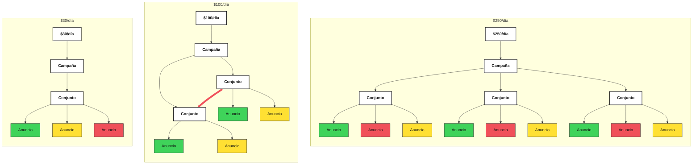
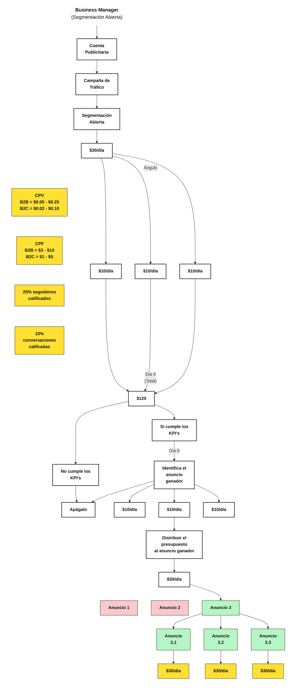
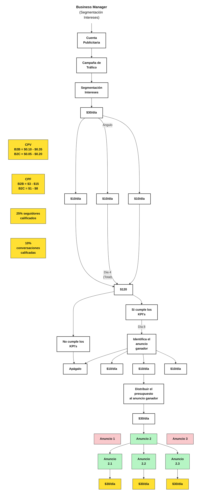
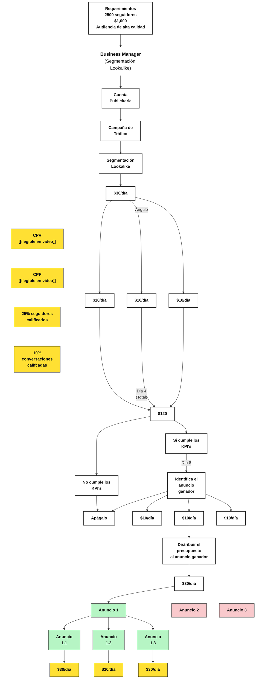

# E04 · Canívoros: estructura de campañas de tráfico en Meta (clon exacto del video)

- **Fuente:** YouTube «Cómo pasé de $0 a $95K en 6 meses con UN solo funnel (nadie habla de esto)» — https://www.youtube.com/watch?v=pSi2YN5NNSQ (47:05). Llamada grabada (Felipe Carvajal, Marcos Poole, José Antonio García Jordán) con un tablero Miro «TRAINING».
- **Tipo:** clon fiel, no adaptación. Lo propio de Canívoros queda como `[[ ]]` o `desconocido`.
- **Estado:** borrador · Creado 2026-11-03.
- **Leyenda de origen:** 🟦 **leído en pantalla** · 🗣️ **dicho por el narrador** · ⚠️ **supuesto**.

El tablero muestra **4 diagramas** (el video no presenta páginas, formularios ni anuncios: es la estructura de prueba y escalado de campañas de tráfico a perfil):

1. Estructuras de campaña por presupuesto: $30/día, $100/día, $250/día (árboles Campaña → Conjunto → Anuncio, coloreados a mano verde/amarillo/rojo).
2. Business Manager (Segmentación Abierta) — flujo de prueba de 8 días y escalado.
3. Business Manager (Segmentación Intereses) — mismo flujo, otros KPI.
4. Requerimientos → Business Manager (Segmentación Lookalike) — mismo flujo.

Las cifras ($, KPI) que aparecen son **las del tablero del video** (🟦), no de Canívoros. Para Canívoros: presupuesto `[[presupuesto diario Canívoros]]`, KPI `desconocido`.

## 1. Estructuras por presupuesto

## 2. Business Manager (Segmentación Abierta)

## 3. Business Manager (Segmentación Intereses)

## 4. Business Manager (Segmentación Lookalike)

## Tabla de etapas (flujos 2–4)

| # | Nodo (tal como se lee) | Qué es | Origen | Canívoros |
|---|---|---|---|---|
| 0 | Requerimientos: 2500 seguidores · $1,000 · Audiencia de alta calidad | Solo flujo Lookalike; narrador: «por lo menos 2,500 seguidores, haber invertido por lo menos $1,000 en ads» (31:55) | 🟦🗣️ | `desconocido` (seguidores y gasto histórico de Canívoros) |
| 1 | Business Manager (Segmentación …) | Encabezado | 🟦 | — |
| 2 | Cuenta Publicitaria → Campaña de Tráfico → Segmentación Abierta / Intereses / Lookalike | Campaña de tráfico a perfil (Instagram) | 🟦 · objetivo «perfil de Instagram» visto en Ads Manager (🟦 ~24:20) | `[[cuenta publicitaria Canívoros]]` |
| 3 | $30/día → (Ángulo) → $10/día ↔ $10/día ↔ $10/día | 1 ángulo creativo, 3 videos a $10/día c/u | 🟦🗣️ (11:20) | `[[ángulo Canívoros]]`, `[[3 videos]]` |
| 4 | Dia 4 (Total) · $120 | No tocar 4 días | 🟦🗣️ (11:43) | — |
| 5 | Si cumple los KPI's / No cumple los KPI's → Apágalo | Decisión día 4 con CPV y CPF | 🟦🗣️ (12:24) | KPI `desconocido` |
| 6 | Día 8 · Identifica el anuncio ganador (los demás → Apágalo) | Setter mide 25% seguidores calificados y 10% conversaciones calificadas | 🟦🗣️ (12:44–13:24) | `[[setter Canívoros]]` |
| 7 | $10/día ↔ $10/día ↔ $10/día → Distribuir el presupuesto al anuncio ganador → $30/día | Todo el presupuesto al ganador | 🟦🗣️ (14:27) | — |
| 8 | Anuncio 1 ↔ Anuncio 2 ↔ Anuncio N (ganador en verde) | Abierta: Anuncio 3; Intereses: Anuncio 2; Lookalike: Anuncio 1 | 🟦 (Lookalike ⚠️ leído en toma amplia) | — |
| 9 | Anuncio N.1 / N.2 / N.3 → $30/día c/u | 3 versiones del ganador grabadas distinto (selfie, doble cámara); repetir el proceso | 🟦🗣️ (15:05–15:49) | `[[versiones del ganador]]` |

KPI del tablero (🟦):

| Flujo | CPV | CPF | Día 8 |
|---|---|---|---|
| Abierta | B2B = $0.05 - $0.25 · B2C = $0.02 - $0.10 | B2B = $3 - $10 · B2C = $1 - $5 | 25% seguidores calificados · 10% conversaciones califcadas |
| Intereses | B2B = $0.10 - $0.35 · B2C = $0.05 - $0.20 | B2B = $3 - $15 · B2C = $1 - $8 | igual |
| Lookalike | `ilegible` | `ilegible` | igual (⚠️ toma amplia) |

## Activos

| Activo | Estado Canívoros |
|---|---|
| Cuenta publicitaria / Business Manager | `[[ ]]` |
| 1 ángulo creativo + 3 videos | `[[ ]]` |
| Setter que califica seguidores y conversaciones | `[[ ]]` |
| Audiencia semilla para Lookalike (2500 seguidores, $1,000 invertidos) | `desconocido` |
| Lista de intereses (narrador: 1 o 5–10 intereses, solo intereses, no job titles/demographics/behaviors, 26:25–26:49) | `[[ ]]` |

## Verificación contra el video (cuadros revisados)

- [x] 00:30 — toma amplia: 3 árboles a la izquierda y 3 columnas de flujo.
- [x] 09:20–10:20 — árboles $30/día, $100/día, $250/día con colores a mano; trazo rojo entre los 2 Conjuntos de $100/día.
- [x] 11:05 — encabezado «Business Manager (Segmentación Abierta)», Cuenta Publicitaria, Campaña de Tráfico, Segmentación Abierta.
- [x] 11:35–12:05 — $30/día, Ángulo, 3×$10/día, Dia 4 (Total), $120, CPV y CPF (abierta).
- [x] 12:40–13:05 — Si/No cumple los KPI's, Apágalo, Día 8, Identifica el anuncio ganador, notas 25%/10%.
- [x] 14:35–15:35 — Distribuir el presupuesto al anuncio ganador, $30/día, Anuncio 1/2 (rosa), Anuncio 3 (verde), Anuncio 3.1/3.2/3.3, $30/día (amarillo).
- [x] 24:20–25:30 — columna Intereses: CPV/CPF distintos; Anuncio 2 en verde.
- [x] 31:50–32:10 — Requerimientos (2500 seguidores, $1,000, Audiencia de alta calidad) → Business Manager (Segmentación Lookalike).
- [x] 32:45 — dos columnas lado a lado: en Lookalike el verde es el Anuncio 1.

## Brechas abiertas

- CPV/CPF del flujo Lookalike: ilegibles (solo vistos en toma amplia).
- Las flechas ↔ entre hermanos ($10/día, Anuncio 1↔2↔3) no se dibujan en mermaid sin romper la disposición; quedan como hermanos en la misma fila. El trazo rojo de $100/día se conserva.
- El orden izquierda-derecha de colores en los árboles lo reordena el motor de mermaid (⚠️ aproximado). En el tablero: $30/día verde-amarillo-rojo; $100/día verde-amarillo | verde-amarillo; $250/día verde-rojo-amarillo ×3 (⚠️ el último leído en toma amplia).
- La flecha Identifica el anuncio ganador → Apágalo sale a la derecha en el tablero; mermaid la ubica distinto.
- Nada del video define páginas, oferta ni precios: para Canívoros todo es `desconocido`.
- 🗣️ Ejemplo del narrador (no del tablero): $1,000 → 100 seguidores → 25 calificados → 10 conversaciones → 1–2 llamadas → venta de 10k, ROAS 10 (13:30–13:54). No aplica a Canívoros.

## Historial

- 2026-11-03 — v1: clon de los 4 diagramas del tablero del video (Grok Bot para Andrés).
